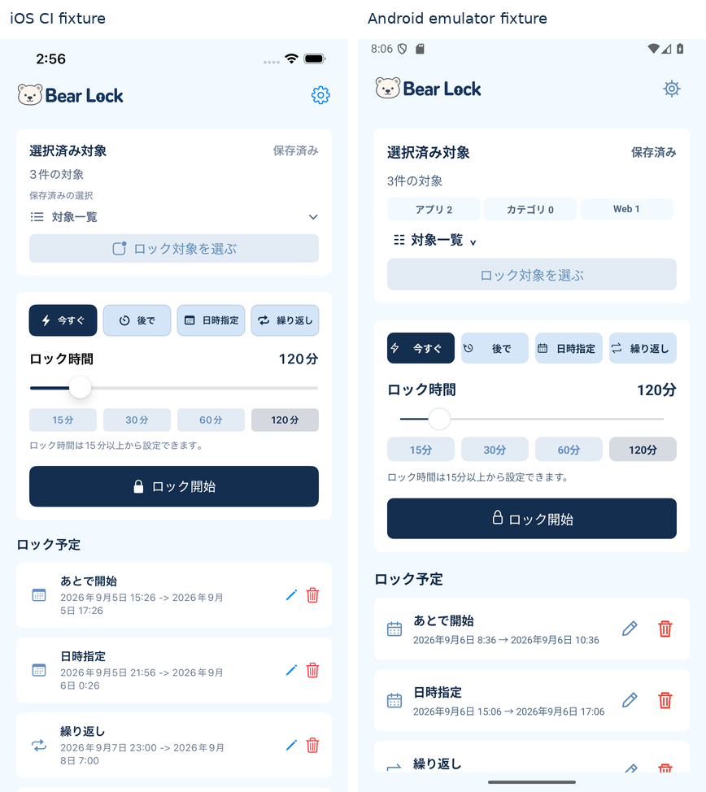
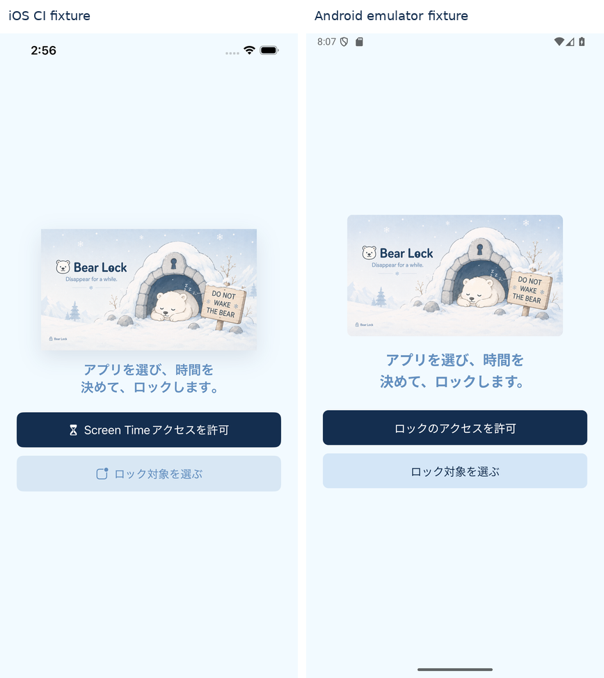
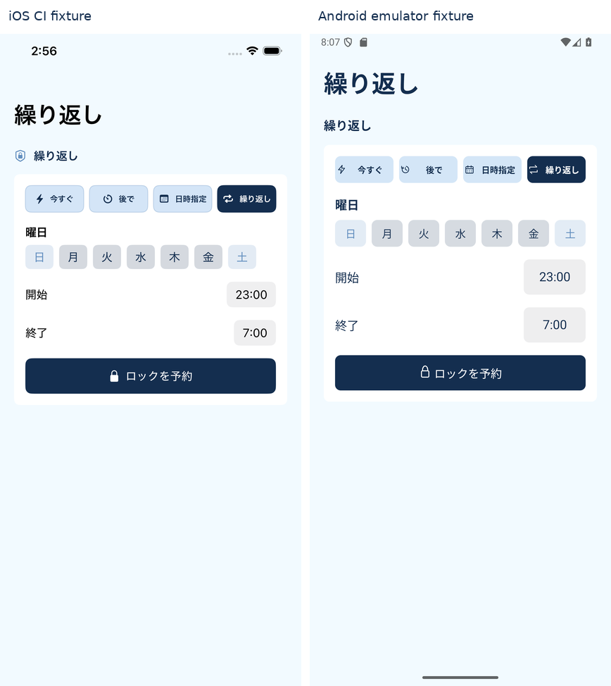
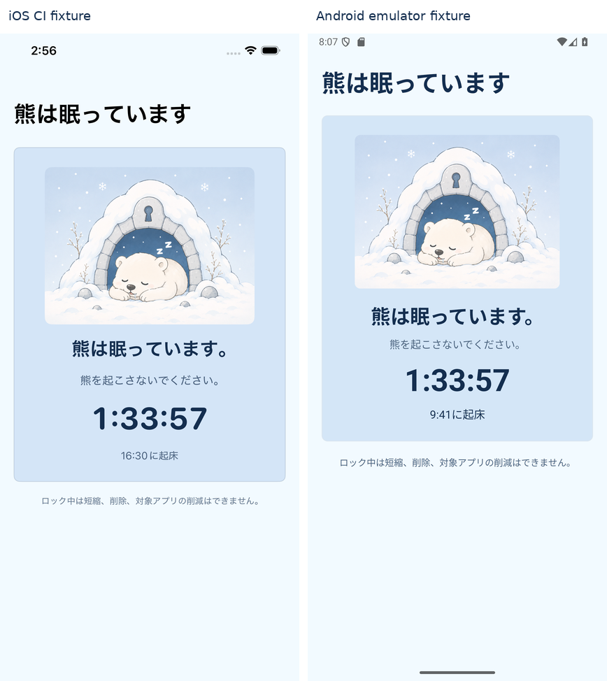
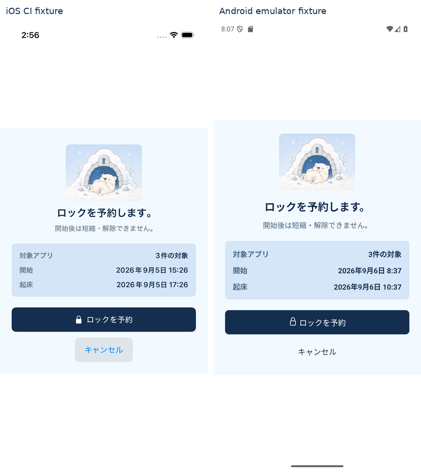
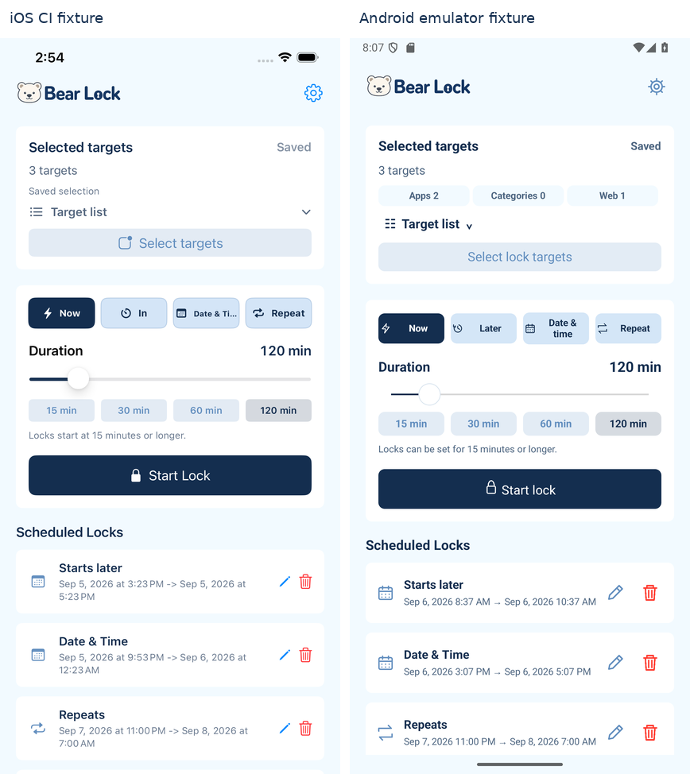
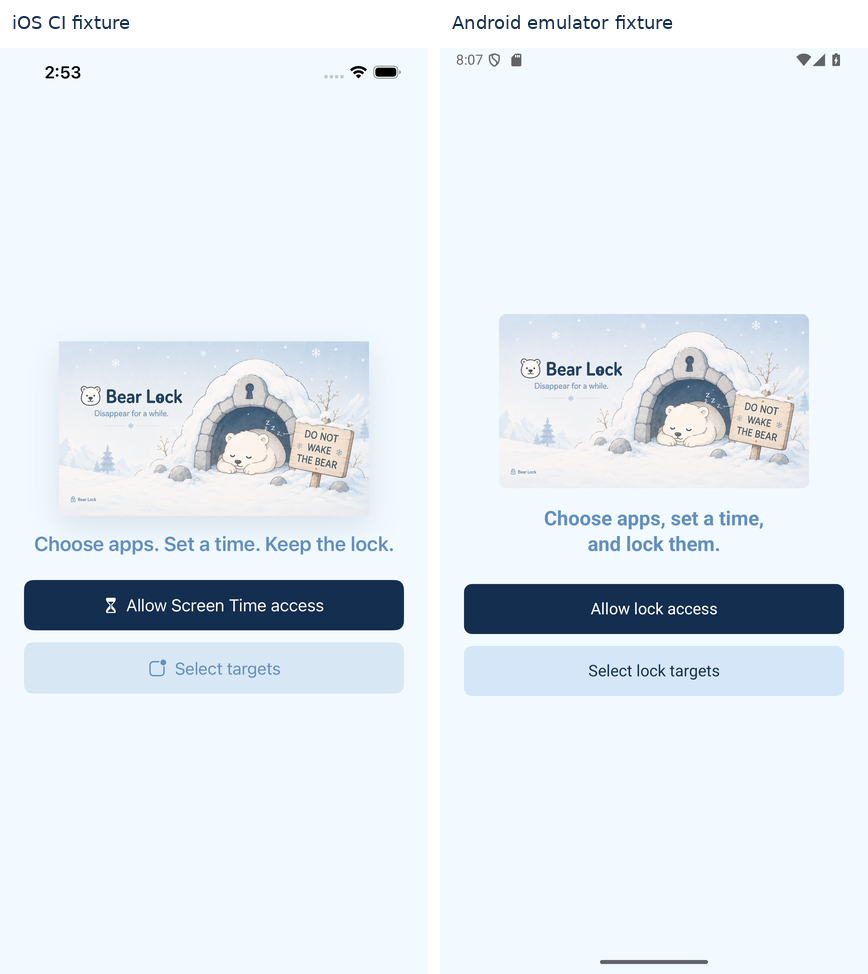
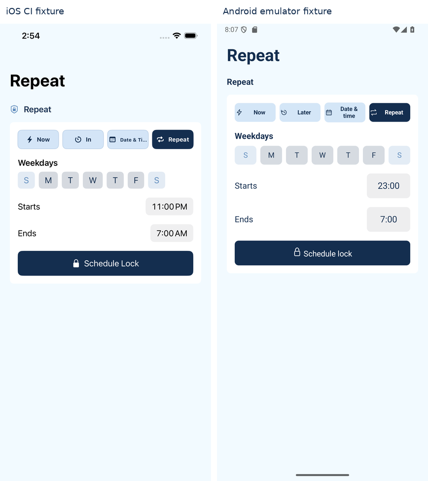
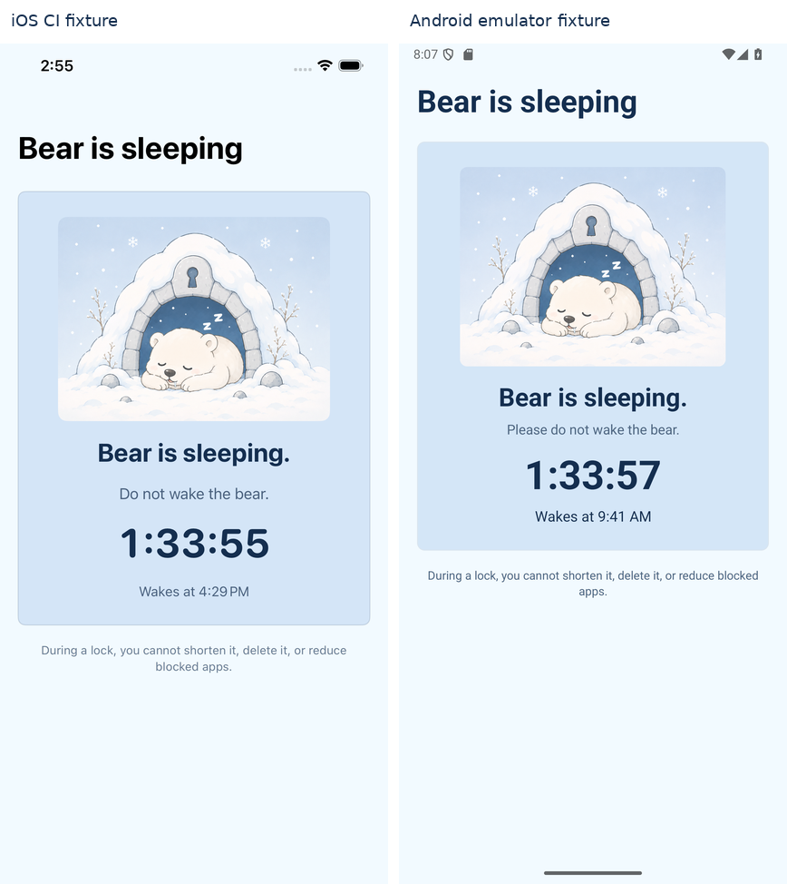
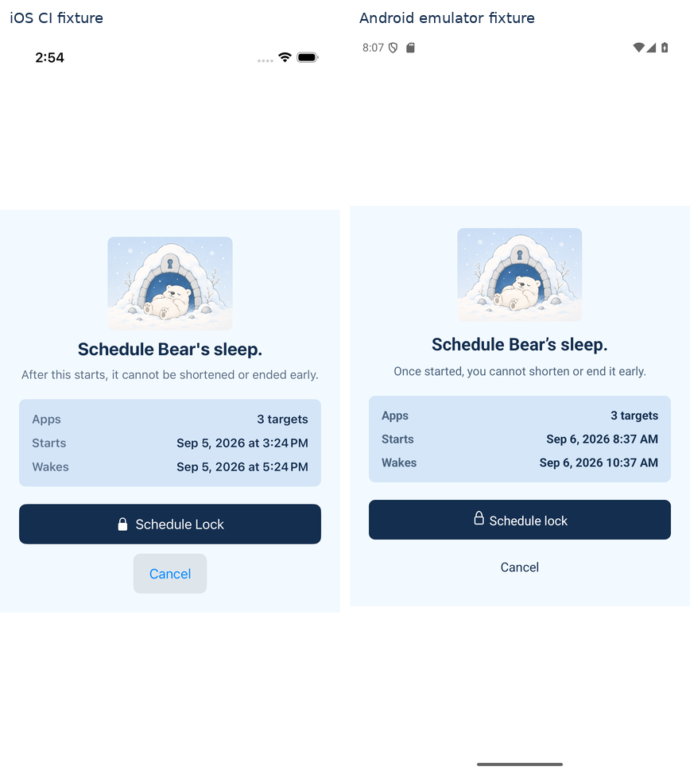

# Android / iOS スクショ比較

**最新の修正版:** [0.1.1のスクショ・17項目への対応](docs/android-ui-refresh-2026-09-08.md)。以下は修正前の比較を履歴として残しています。

**2026-09-08レビュー:** [余白・配置・文字の問題一覧（17項目）](docs/android-ui-review-2026-09-08.md)。以下の画像は前回撮影分です。当時の問題と今回の修正結果を上のリンクから確認できます。

**左が iOS、右が修正後の Android です。** 主要5画面を日本語・英語で比較しています。

ホームの独自ヒーローと下部タブを撤去し、iOS の画面構成・既存素材・入力操作を基準に実装し直しました。繰り返し予約のオン／オフ、対象の保存・取消、固定フッターなどの不足も対応しています。

[実装内容・残る差分](docs/android-ui-parity.md) · [TODO](docs/android-ui-parity-todo.md) · [Android ソース](android-lab/product/src/main/java/com/hiyozoo/bearlock)

iOS はリポジトリに保存されている CI 撮影画像、Android は今回のエミュレーター撮影です。比較用画像は両方ともプレビュー状態であり、制限機能の実証と混同しないよう区別しています。原寸は両方 1284×2778、Android は 428×926 dp / 文字100%です。

## 日本語

### ホーム

ロゴ、対象、時間設定、予定の順序を統一。Android は実際の件数内訳を表示するため、iOS CI の「保存済みの選択」より対象カードが高くなります。

[赤色のピクセル diff](docs/qa/android-ui-parity/compare/ja/home-diff.png) · [iOS 原寸](docs/qa/android-ui-parity/ios/ja/home.png) · [Android 原寸](docs/qa/android-ui-parity/android/ja/home.png)

### セットアップ

同じ BrandHero・説明・二つの主操作。アクセス先は Android のユーザー補助／アラーム設定です。

[赤色のピクセル diff](docs/qa/android-ui-parity/compare/ja/setup-diff.png) · [iOS 原寸](docs/qa/android-ui-parity/ios/ja/setup.png) · [Android 原寸](docs/qa/android-ui-parity/android/ja/setup.png)

### 繰り返し

同じ横一列のモードと曜日、23:00→7:00。OS の上端余白、時刻ボタンの高さ、字体・行間が異なります。

[赤色のピクセル diff](docs/qa/android-ui-parity/compare/ja/composeRepeat-diff.png) · [iOS 原寸](docs/qa/android-ui-parity/ios/ja/composeRepeat.png) · [Android 原寸](docs/qa/android-ui-parity/android/ja/composeRepeat.png)

### ロック中

同じ Sleeping の熊・青いカード・カウントダウン。字体、カード内の間隔、上端位置、起床時刻が異なります。これは表示用フィクスチャで、実ロックの証拠は下に分けています。

[赤色のピクセル diff](docs/qa/android-ui-parity/compare/ja/activeLock-diff.png) · [iOS 原寸](docs/qa/android-ui-parity/ios/ja/activeLock.png) · [Android 原寸](docs/qa/android-ui-parity/android/ja/activeLock.png)

### 確認

同じ Arming の熊と対象／開始／起床の要約。Android のキャンセル操作はテキストボタン、実際の確認はボトムシートです。

[赤色のピクセル diff](docs/qa/android-ui-parity/compare/ja/confirmation-diff.png) · [iOS 原寸](docs/qa/android-ui-parity/ios/ja/confirmation.png) · [Android 原寸](docs/qa/android-ui-parity/android/ja/confirmation.png)

## English

英語版の5画面を開く

### ホーム

### セットアップ

### 繰り返し

### ロック中

### 確認

## 実際の操作とロック

以下は比較用フィクスチャではなく、通常の製品画面／サービスで行った操作の記録です。

| 確認 | 証拠 |
|---|---|
| 対象の取消・保存、Web永続化、履歴ピン、予約の作成・編集・削除、繰り返し切替 | [UI検証結果](docs/qa/android-ui-parity/interactions/result.json) |
| 空の選択では保存不可、選択すると保存可能 | [フッター検証](docs/qa/android-ui-parity/interactions/footer-result.json) |
| アプリのタップ遮断と自然終了後の入力復帰 | [Probeログ](docs/qa/android-ui-parity/verification/result.json) |
| Chromeのリンク遮断と自然終了後の遷移 | [Chrome結果](docs/qa/android-ui-parity/web-verification/result.json) |
| Debug / Release / AAB / lint、20ユニットテスト | [ビルドログ](docs/qa/android-ui-parity/build.log) · [検証サマリー](docs/qa/android-ui-parity/summary.json) |

[対象アプリ](docs/qa/android-ui-parity/interactions/targets-apps.png) · [Web](docs/qa/android-ui-parity/interactions/targets-web.png) · [カテゴリ](docs/qa/android-ui-parity/interactions/targets-categories.png) · [確認シート](docs/qa/android-ui-parity/interactions/confirmation-sheet.png) · [予約編集](docs/qa/android-ui-parity/interactions/scheduled-editor.png) · [繰り返し編集](docs/qa/android-ui-parity/interactions/recurring-editor.png) · [権限](docs/qa/android-ui-parity/interactions/permissions.png)

[実ロック中のホーム](docs/qa/android-ui-parity/verification/active-home.png) · [実アプリのブロック画面](docs/qa/android-ui-parity/verification/shield-active.png) · [Webのブロック画面](docs/qa/android-ui-parity/web-verification/web-shield-active.png)

### 320dp・文字150%

文字が縦に潰れないよう、この条件ではモード・プリセットを横スクロールにしています。TalkBackや全ての文字サイズの検証完了を意味するものではありません。

[ホーム](docs/qa/android-ui-parity/accessibility/home-320dp-font150.png) · [繰り返し](docs/qa/android-ui-parity/accessibility/repeat-320dp-font150.png)

## ピクセル diff の読み方

赤は RGB 各チャンネルの最大絶対差が24を超えた画素です。OSバー、撮影日時、字体、内訳表示、余白も含みます。**この割合は機能一致率や品質スコアではありません。** 画像の位置合わせや日時置換は行っていません。

| 画面 | 日本語の変更画素 | 英語の変更画素 |
|---|---:|---:|
| ホーム | 25.9% | 18.0% |
| セットアップ | 8.8% | 9.2% |
| 繰り返し | 13.9% | 15.9% |
| ロック中 | 24.0% | 27.5% |
| 確認 | 7.4% | 6.5% |

[画素差分と元画像のSHA-256](docs/qa/android-ui-parity/pixel-diff.json) · [再生成スクリプト](android-lab/scripts/android_screenshot_diff.py)

初期実装のスクショは [旧ギャラリー](docs/qa/android-product/README.md) に残しています。現在の UI はこのページが基準です。
