# Android スクリーンショット

Android 15 エミュレーターで撮影した実画面23枚。画像ファイルは `docs/qa/android-product/` に保存しています。

| ホーム | 実行中 | アプリの遮断 |
| --- | --- | --- |
| 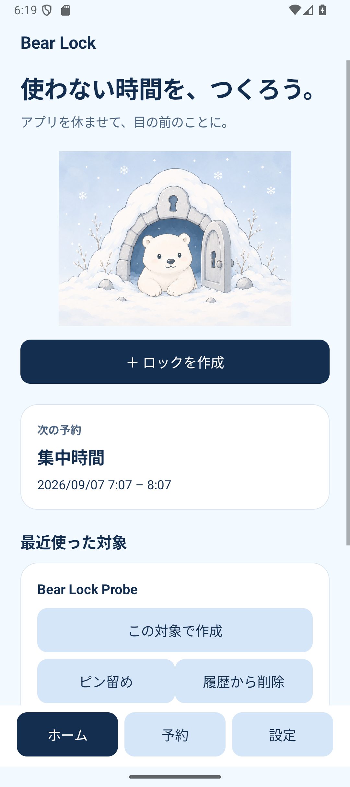 | 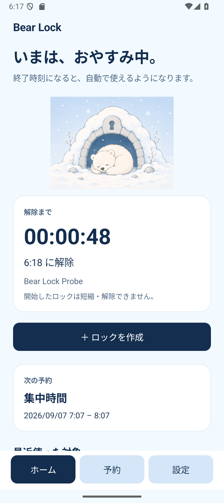 | 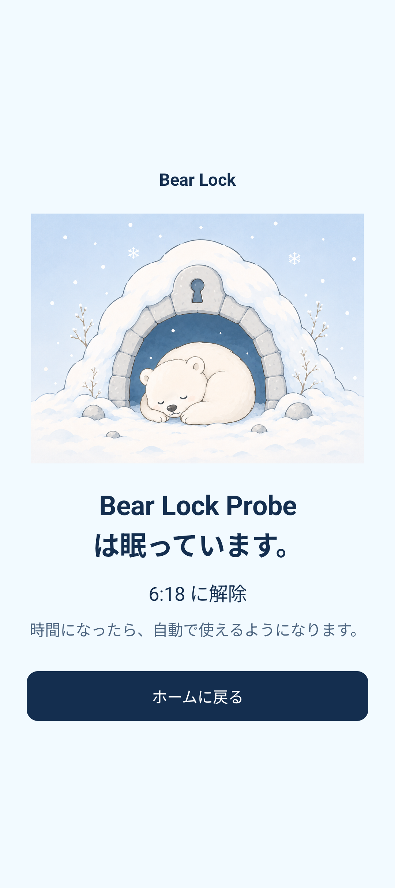 |

| ロック作成 | 遅延開始 | 日時指定 |
| --- | --- | --- |
| 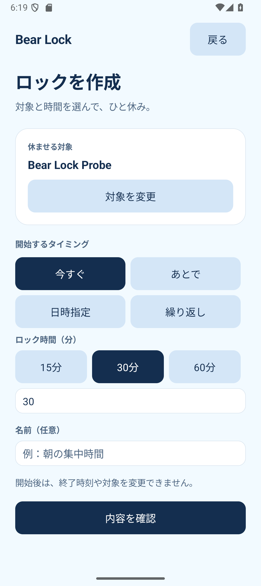 | 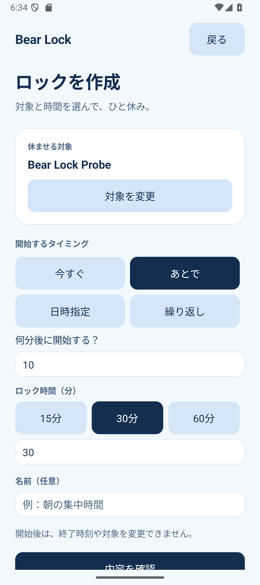 | 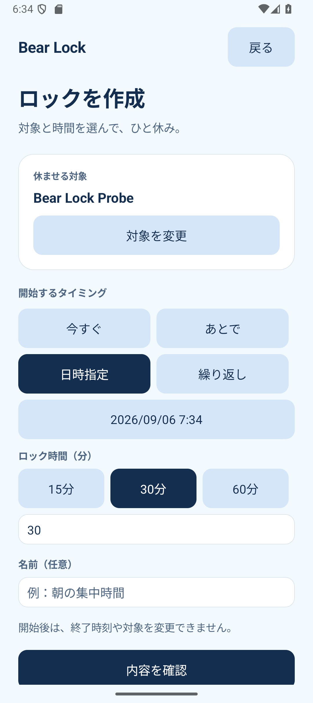 |

| 繰り返し | 予約一覧 | 実行中の予約 |
| --- | --- | --- |
| 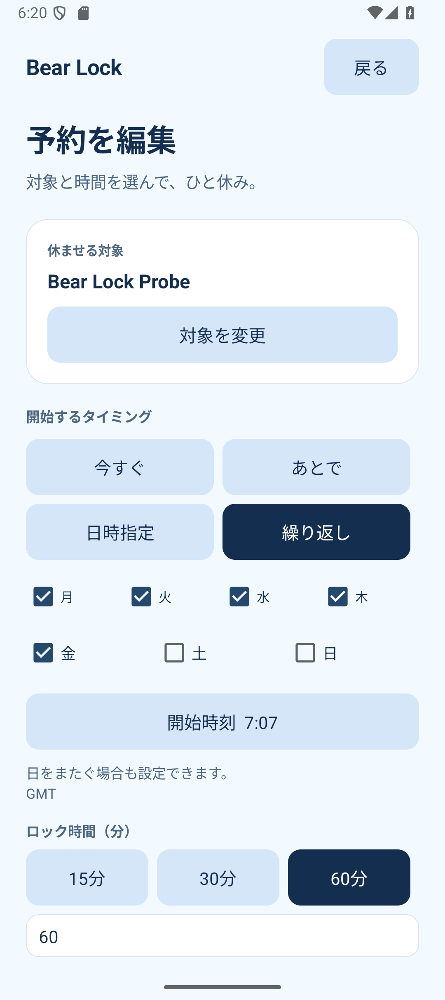 | 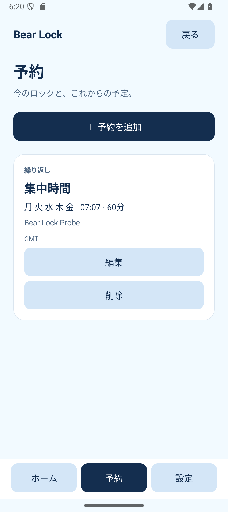 | 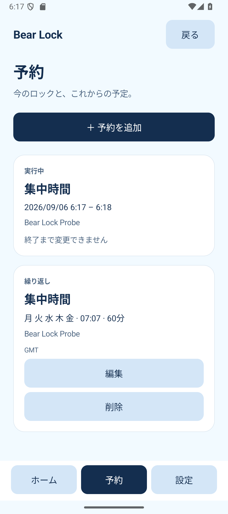 |

| 確認 | アプリ選択 | Web選択 |
| --- | --- | --- |
| 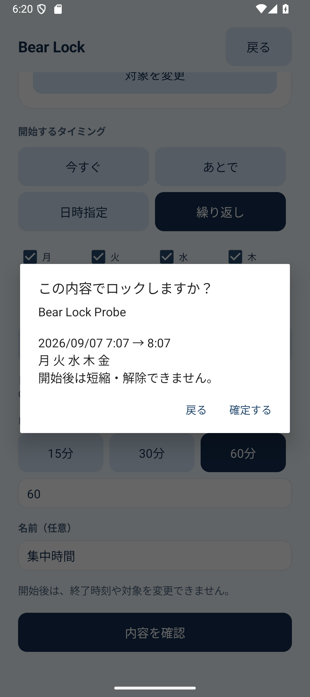 | 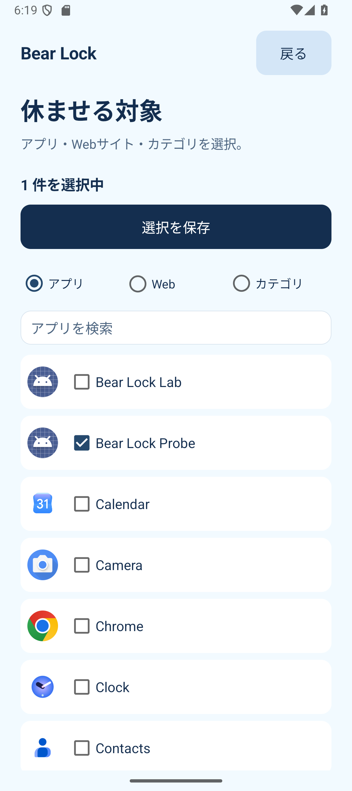 | 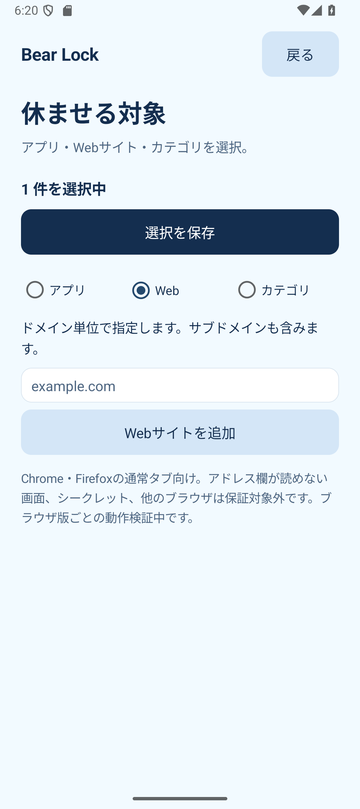 |

| カテゴリ選択 | 初回設定 | 権限説明 |
| --- | --- | --- |
| 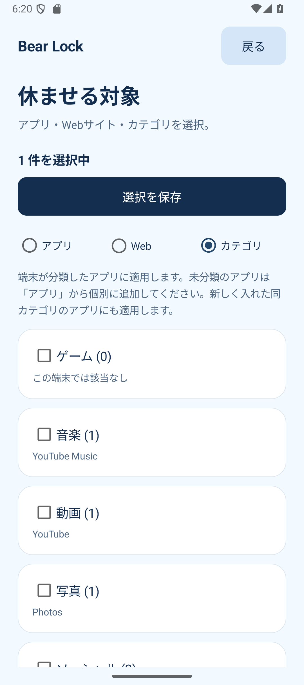 | 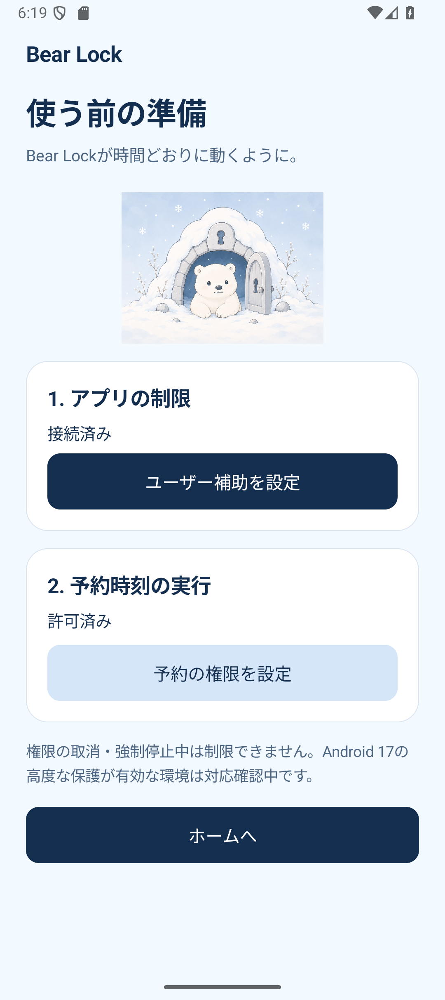 | 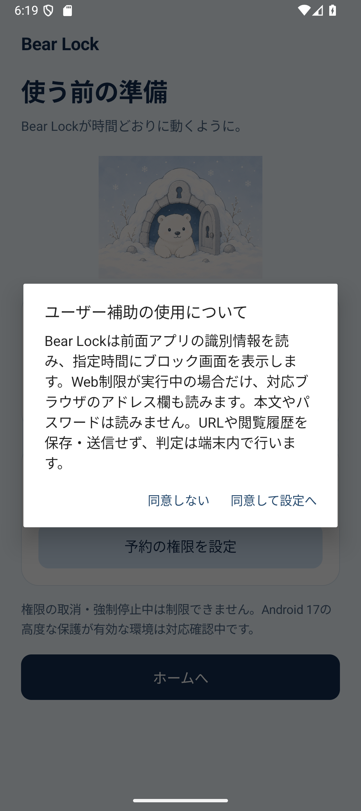 |

| 設定 | Webの遮断 | Webの操作遮断 |
| --- | --- | --- |
| 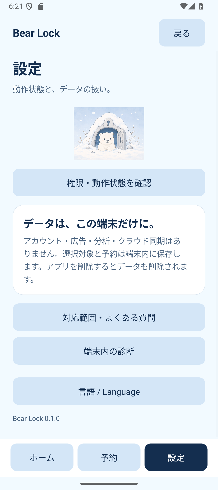 |  | 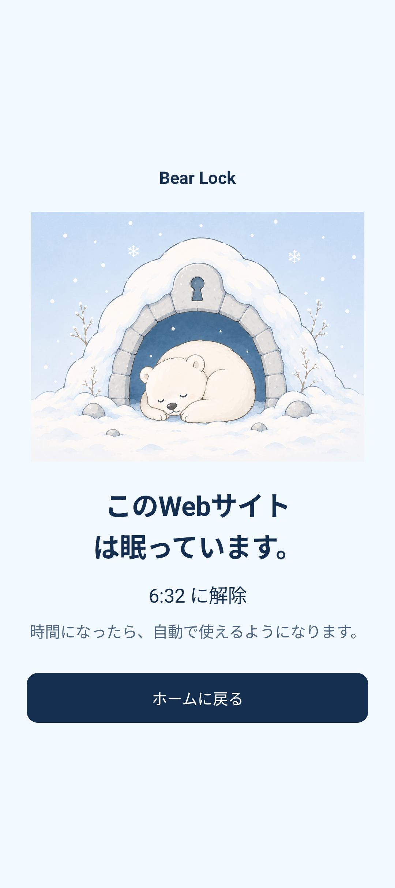 |

| Webの解除後 | 解除後のリンク操作 | アプリの解除後 |
| --- | --- | --- |
| 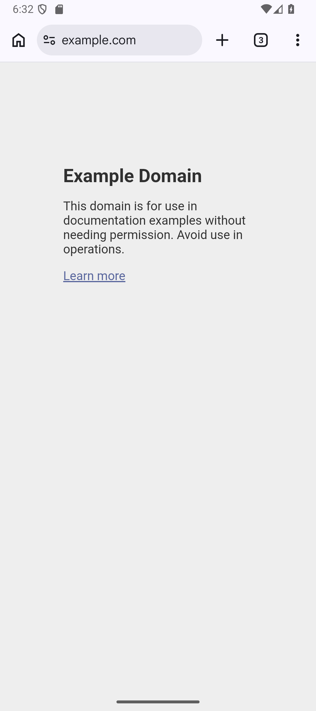 | 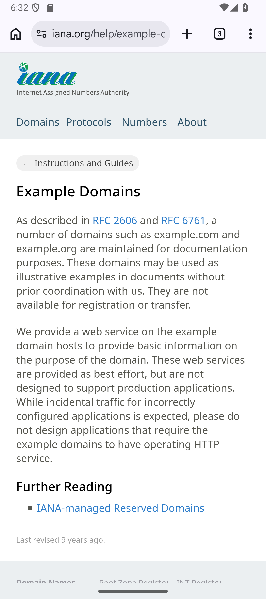 | 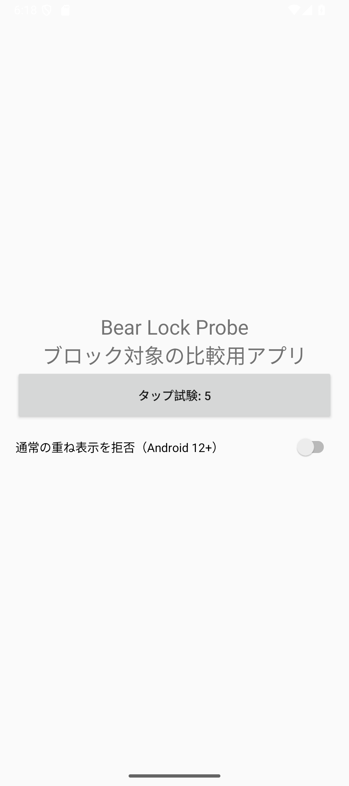 |

| 英語ホーム | 英語の作成画面 |
| --- | --- |
| 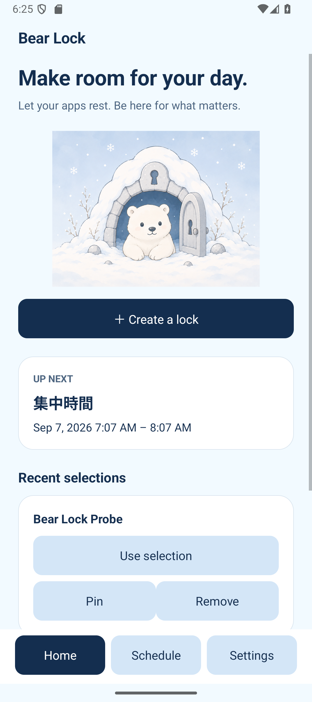 | 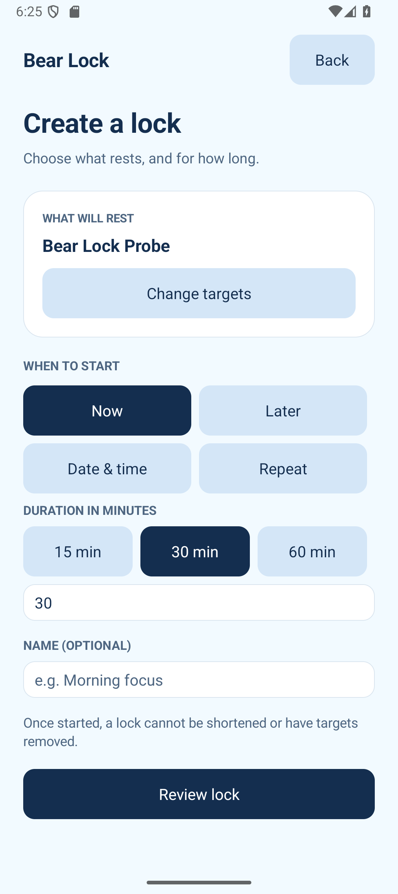 |
