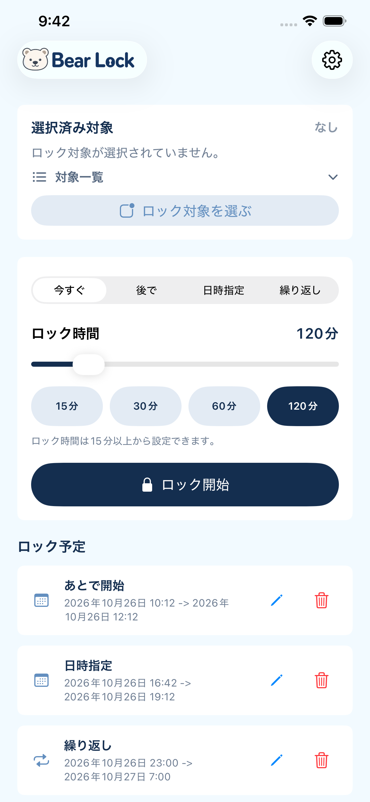
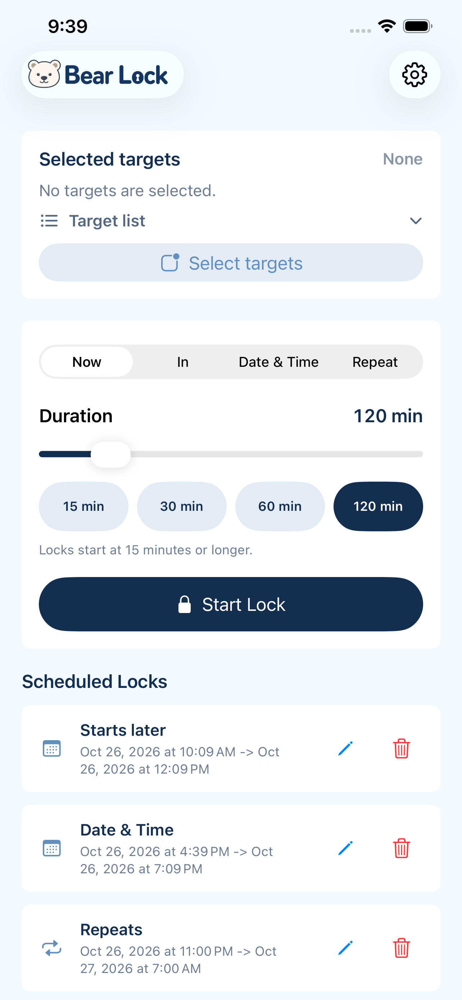
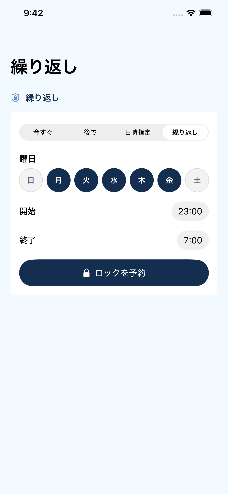
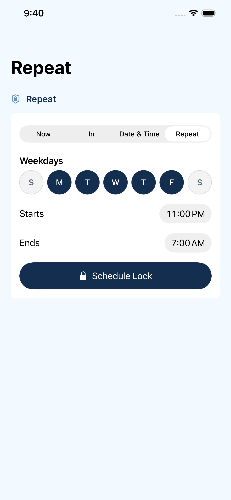
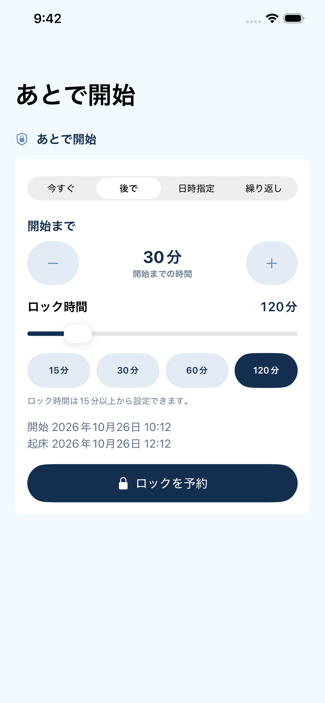
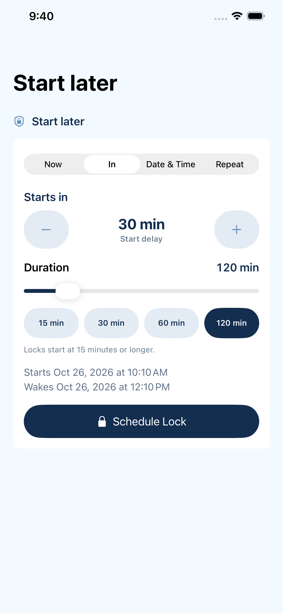
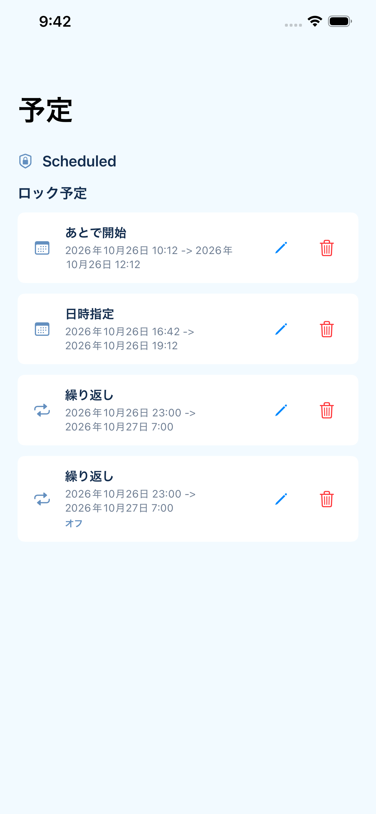
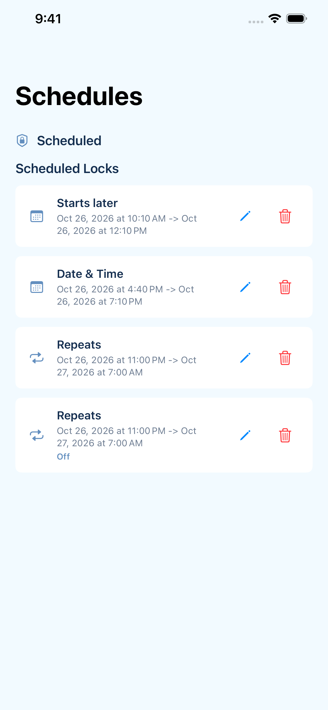

# Current iOS screenshots

The current English and Japanese simulator captures are in `app-store-en` and `app-store-ja` (16 screens per locale). [Source metadata](app-store-source.json) identifies the exact source commit, GitHub Actions run, and files.

These use the screenshot app's fixtures. They show the current UI, not evidence of actual Screen Time blocking. Interactive E2E evidence and the before/after review are recorded in [the selection-controls review](../docs/qa/ios-selection-controls-2026-10-11.md). Dated QA and Android comparison images elsewhere remain historical records.

The 2026-10-26 captures come from [CI run 207](https://github.com/hiroyoshii/bearlock/actions/runs/40295110542), source `5766aa1`. All 32 PNGs are 1284x2778. Product code matches TestFlight 1.3 build 39 (`e3af31e`); intervening changes affect tests and records only. Normal-device UI: 27 passed, 1 failed, 0 skipped. Small iPhone selection UI: 7 passed, 0 failed, 0 skipped. Screenshot capture succeeded, but the full E2E suite is not green. The unresolved failure is `testDurationPresetsAndModeReflectCurrentValue`. These files have not yet replaced the App Store Connect gallery.

| Screen | Japanese | English |
|---|---|---|
| Home |  |  |
| Repeat |  |  |
| Starts later |  |  |
| Scheduled locks |  |  |
