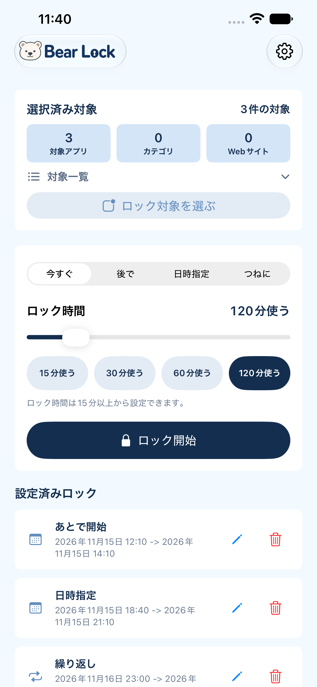
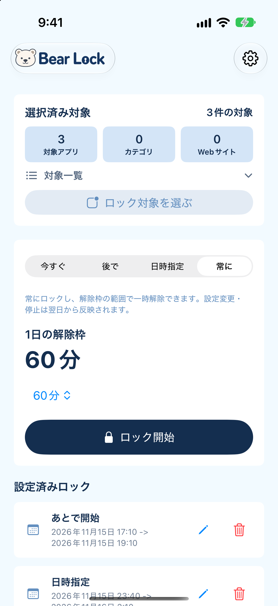
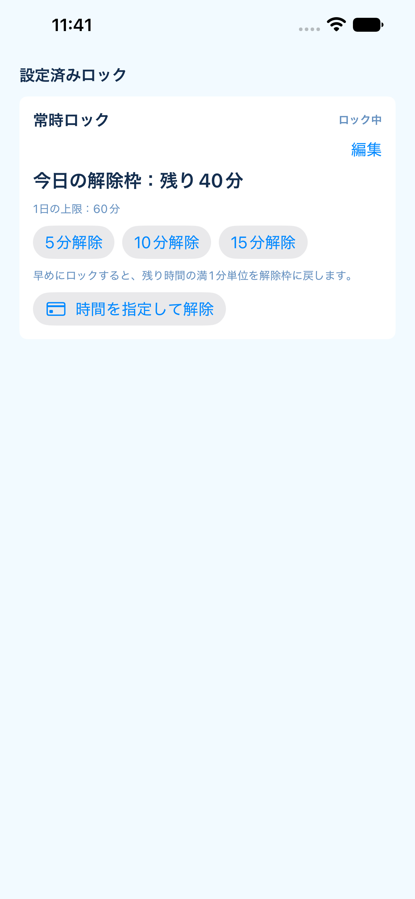

# Current iOS screenshots

The current Japanese and English screenshot galleries are in `app-store-ja` and `app-store-en`: 25 screen states per locale, captured on 2026-11-15 from the current 1.4 source using an iPhone 17 Simulator. All prior gallery images in these folders were replaced, so old UI captures are not mixed into the current gallery. Dimensions, selected App Store slots, source commit, and per-file hashes are recorded in [app-store-source.json](app-store-source.json).

The five App Store listing candidates per locale are `setup.png`, `home.png`, `composeAlways.png`, `confirmation.png`, and `activeLock.png`. The exact 10 upload copies for app version 1.4 are grouped in `docs/launch/app-review/ios-1.4-app-version/`. The other captured states cover regular scheduling, recurring schedules, and daily allowance states. The timed-unlock IAP review attachment is stored separately at `docs/launch/app-review/ios-1.4-timed-unlock-iap-ja.png`.

These images use screenshot-app fixtures. They show the UI, not evidence of actual Screen Time blocking. The local captures have not been uploaded to App Store Connect; compare them with the final TestFlight build and existing Connect gallery before replacing listing images.

Interactive E2E evidence and the before/after review are recorded in [the selection-controls review](../docs/qa/ios-selection-controls-2026-10-11.md). Historical captures remain available through Git history.

| Screen | Japanese | English |
|---|---|---|
| Home |  |  |
| Always Lock setup |  |  |
| Allowance available |  |  |
| Temporary unlock |  |  |
| Recurring schedule |  |  |
