# Current iOS screenshots

The current English and Japanese simulator captures are in `app-store-en` and `app-store-ja` (25 screens per locale). [Source metadata](app-store-source.json) identifies the source commit, capture time, local tools, simulator, dimensions, and files.

These use the screenshot app's fixtures. They show the current UI, not evidence of actual Screen Time blocking. Interactive E2E evidence and the before/after review are recorded in [the selection-controls review](../docs/qa/ios-selection-controls-2026-10-11.md). Dated QA and Android comparison images elsewhere remain historical records.

The 2026-11-15 captures were rebuilt from the current source and captured locally on an iPhone 14 Plus with iOS 27.0, at 1284 × 2778 pixels. The set includes always-lock setup, daily allowance states, and the remaining allowance after an early manual end. All 50 images are checked for dimensions and blank output. XcodeGen was unavailable locally, so the existing generated Xcode project was used for the screenshot app build. This capture validates the screenshot app and images; it does not replace interactive Screen Time validation.

| Screen | Japanese | English |
|---|---|---|
| Home |  |  |
| Repeat |  | 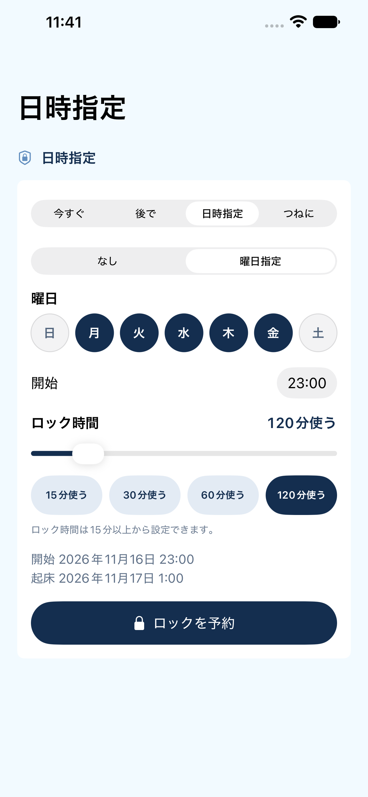 |
| Starts later | 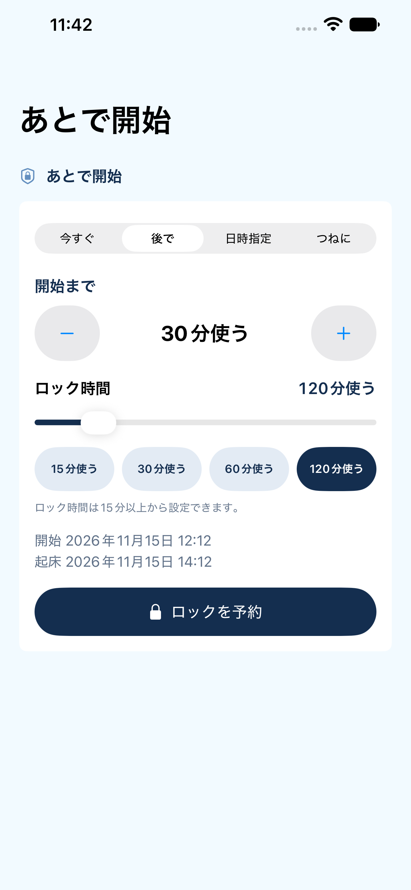 | 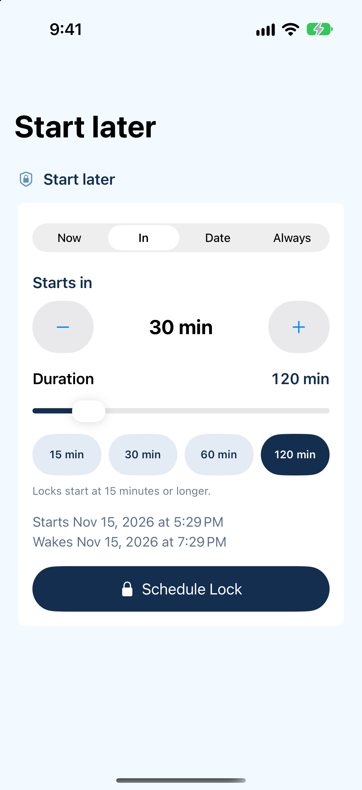 |
| Scheduled locks | 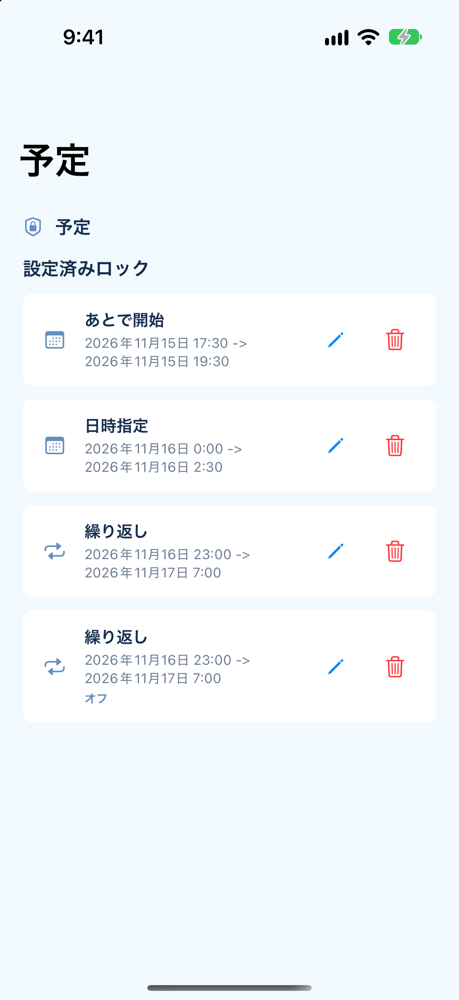 | 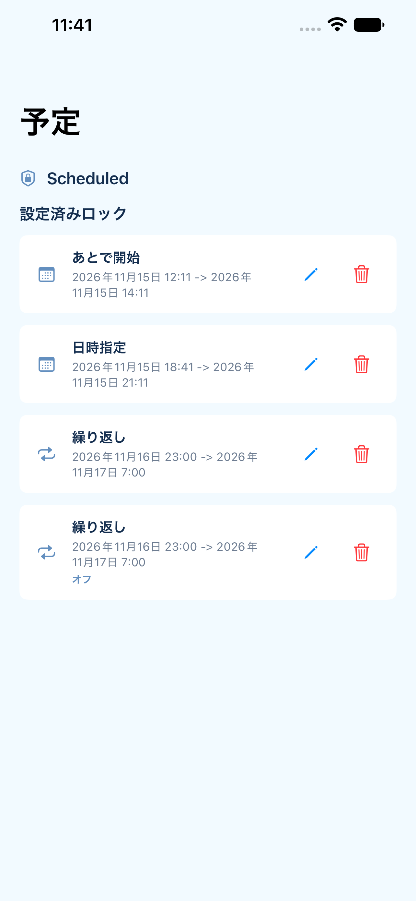 |
| Always lock setup |  | 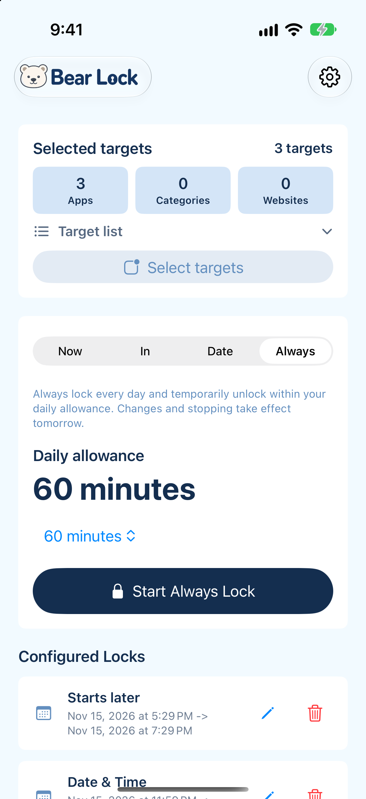 |
| Always lock target selection | 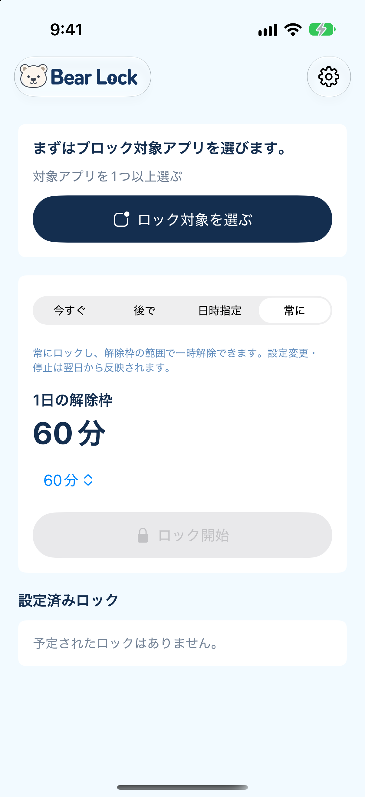 | 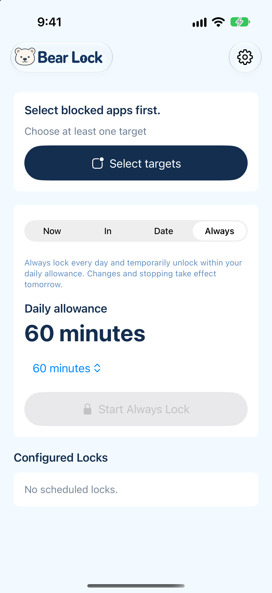 |
| Daily allowance available |  |  |
| Temporary unlock | 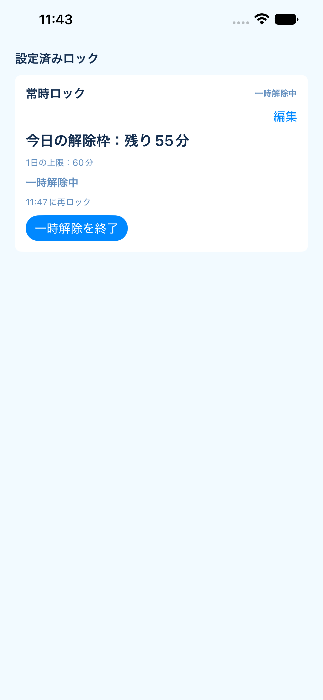 | 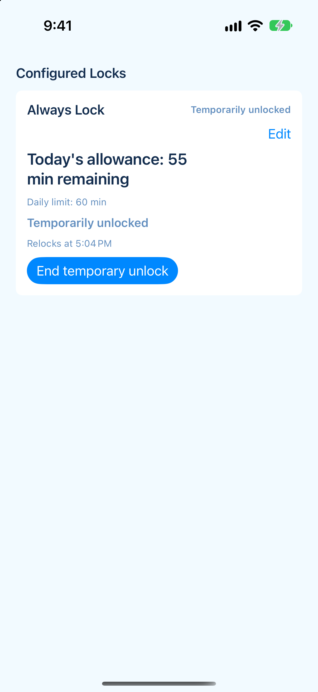 |
| After early end | 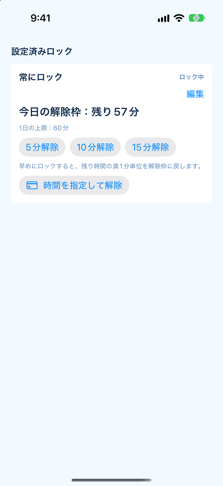 | 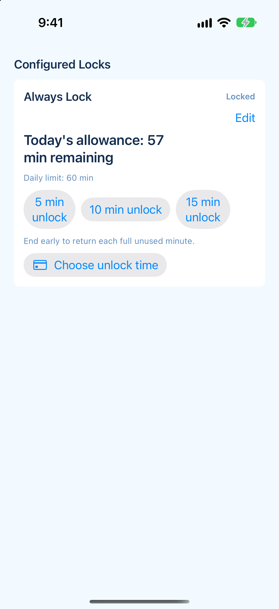 |
| Allowance exhausted | 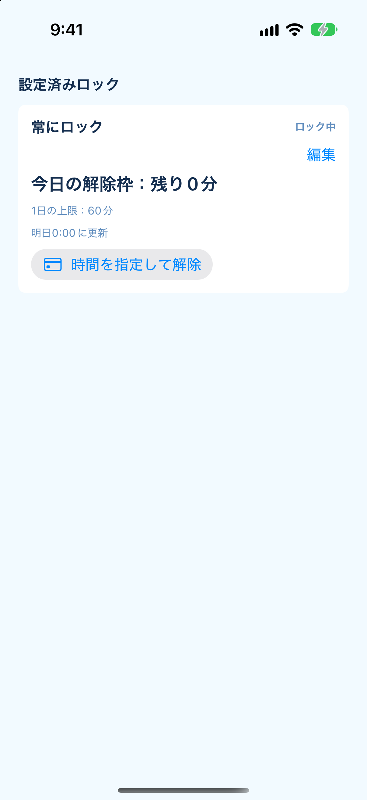 | 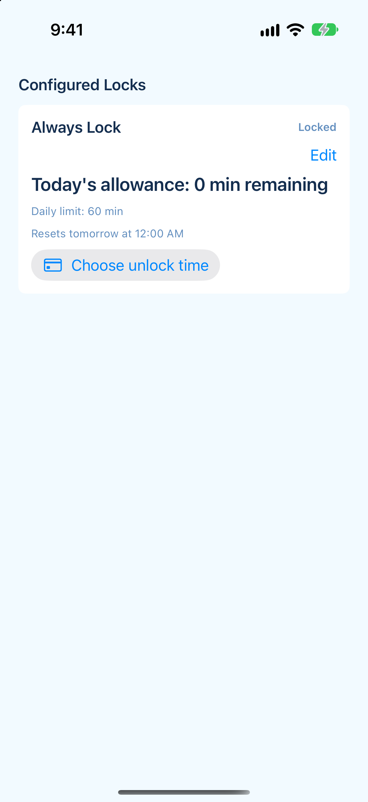 |
| Tomorrow's allowance | 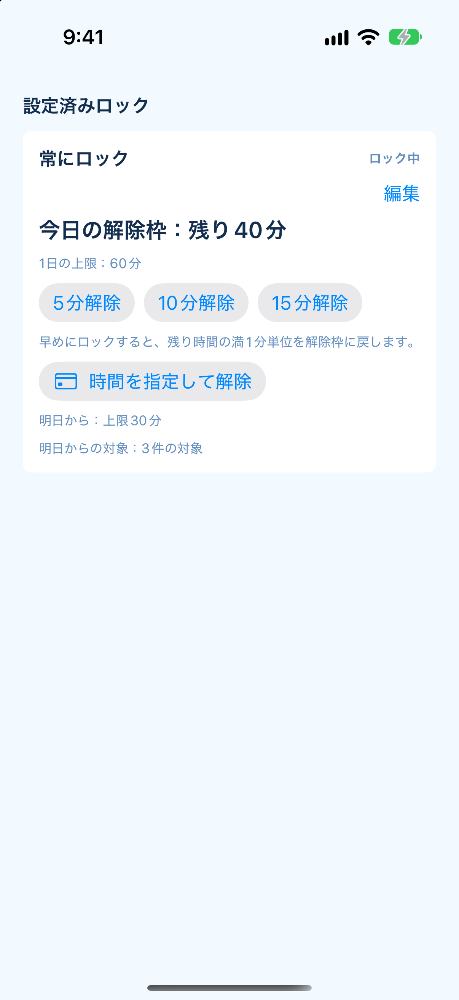 | 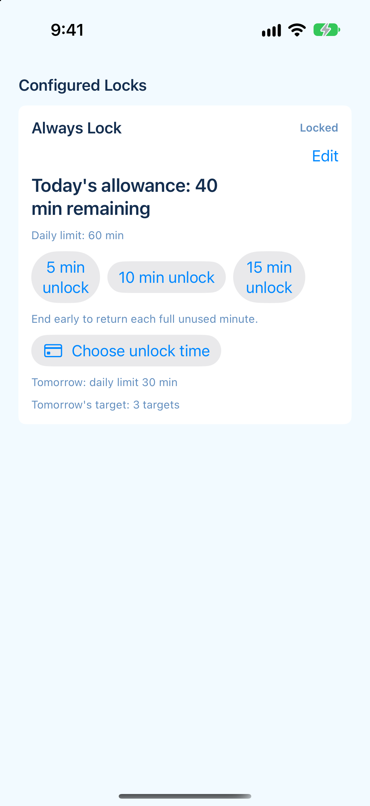 |
| Stopped | 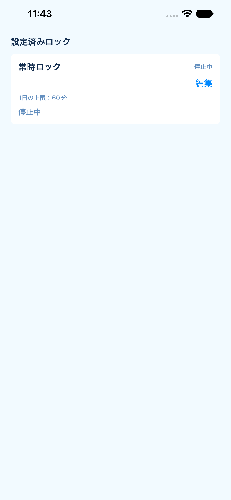 | 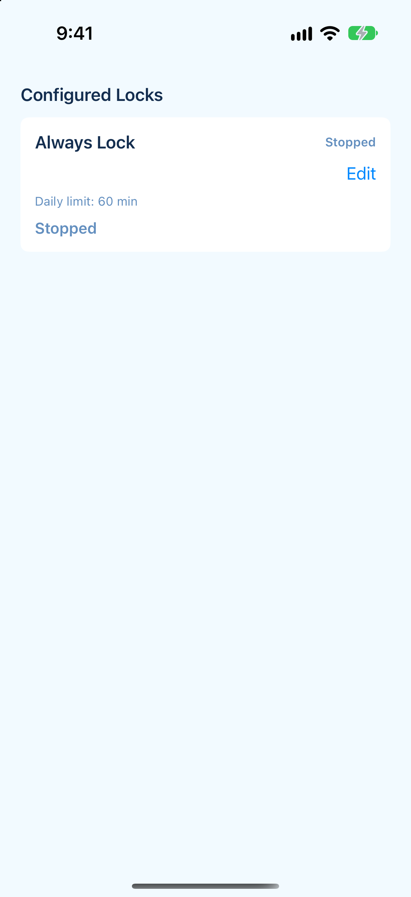 |
