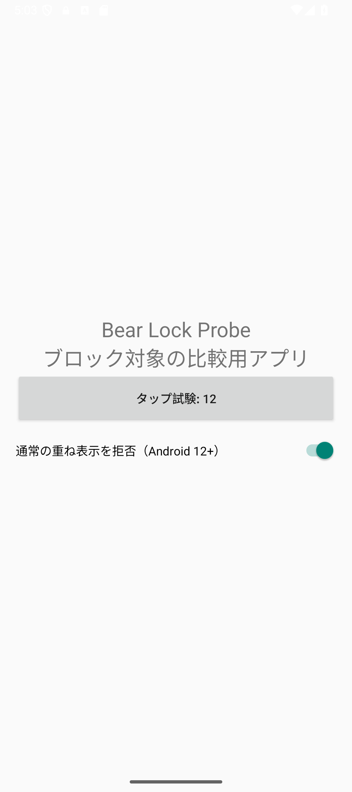
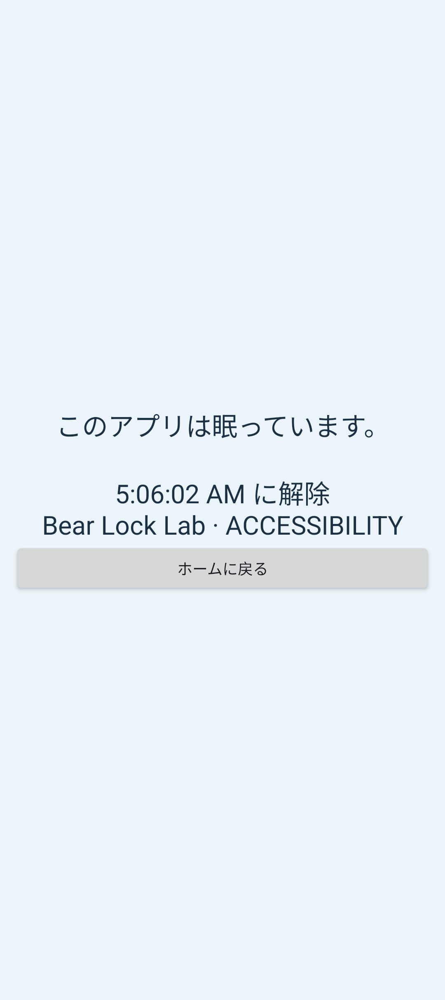

# Android の小規模比較結果

> 2026-10-26整理: 本文は当時の検証記録です。旧画像・途中ログは作業ツリーから削除し、Git管理されていた証跡は固定コミットの履歴へリンクしています。整理済みのローカル出力は同梱していません。

2026-09-06。`android-lab/` に Kotlin の試作と対象側の Probe アプリを作成し、Windows Android Emulator の Pixel_9a AVD（Android 15 / API 35、x86_64）で測定した。compileSdk / targetSdk は36。実機・Android 17の試験ではない。

## 判断

**アプリ単位のブロックは方式 B（Accessibility 検知＋Accessibility Overlay）を主候補にする。** 今回の決め手は速度ではなく、通常の重ね表示を拒否する対象アプリでも遮断できたこと。

方式 A（UsageStats＋Application Overlay）も通常条件では使えるが、対象アプリ側のオーバーレイ拒否で操作できてしまった。iOS と同等の対象範囲を約束する標準方式にはしづらい。Accessibility が利用できない端末向けの限定的な代替として残すかは、対応範囲を明示できるかで判断する。

これは試作の採用候補であり、本番品質・Google Play 審査・全アプリ互換の保証ではない。

**追試で、サービス復帰時の前面アプリ再判定を実装した。** 接続前から対象が開いている条件で、遮断・ホーム移動・再入場・自然終了・終了後の再接続を確認した。端末再起動の追試は System UI の応答停止が入り、入力検証を完了できていない。[修正後の結果](android-recovery-results.md)を参照。以下の比較値と再起動失敗の記録は修正前のもの。

## エミュレーターで確認したこと

| 条件 | A: 使用状況＋通常の重ね表示 | B: Accessibility＋専用の重ね表示 |
| --- | --- | --- |
| 即時ロック後に対象アプリを開く（各3回） | 3/3で試験タップを遮断 | 3/3で試験タップを遮断 |
| 対象アプリを開いたまま8秒後に予約開始 | 遮断 | 遮断 |
| 開始前に消灯・強制Doze、開始後に復帰 | 復帰後の試験タップを遮断 | 復帰後の試験タップを遮断 |
| 対象側が通常の重ね表示を拒否 | **遮断できず、試験タップが届いた** | 遮断 |
| 上記各ケースで終了後に対象をタップ | 6/6で操作できた | 6/6で操作できた |

各ケースのロック期間中に1回、終了後に1回のタップを送って対象アプリのログで判定。入力を連打して全フレームの抜け道を検証したものではない。消灯ケースは「復帰後に制限できる」の確認で、画面が消えている間の表示時刻の保証ではない。Doze はADBで強制した短い試験で、夜間の長時間放置やOEM独自制御とは異なる。

入力試験前の画面:

| A: 対象画面が操作可能なまま | B: ブロック画面が表示される |
| --- | --- |
|  |  |

この差は検知 API だけの比較ではなく、使用する Overlay の種類も含めた方式全体の差。Android は通常のオーバーレイを拒否する機構を提供している。[Android 公式: Secure sensitive activities](https://developer.android.com/security/fraud-prevention/activities)

## 時間の参考値

対象側の `onResume` から `WindowManager.addView` が返るまで:

| 試行 | A | B |
| --- | --- | --- |
| 1 | 1,139 ms | 227 ms |
| 2 | 218 ms | 377 ms |
| 3 | 283 ms | 461 ms |

開いたまま予約時刻を迎えた試験では、開始予定から addView まで A 164 ms、B 35 ms。通常比較6件の終了予定から Overlay の削除まで、A 92〜242 ms、B 30〜36 ms。

addView / フレームコールバックは実際の画面合成完了時刻ではない。エミュレーターの負荷、JIT、ログ出力、試行順に影響される小標本のため、速度の優劣や電池消費の結論には使わない。起動直後の短い操作可能時間も別途測る必要がある。

## 試作中に修正した問題

- A の初期履歴を順番に再生すると、以前開いていた対象のブロック画面を一瞬表示した。最新の前面遷移だけを反映するよう変更。
- A で問い合わせ終了時刻をそのまま次回の開始にすると、遅れて反映された利用イベントを取りこぼした。直近5秒を重ねて検索し、処理済み時刻より新しい最新イベントだけを採用するよう変更。
- 初期の測定ではエミュレーターの System UI の応答停止ダイアログがあったため、その状態の画面を結果に含めず、復旧後に試験を実施。

表は修正後の `run3` のみを使用する。初期失敗を含むローカル試行は `artifacts/android-comparison/`（旧ローカル出力・整理済み） に残る。

## iOS の機能を提供する見通し

[機能対応表](android-feature-parity.md)に現在のiOS機能を列挙した。即時・予約・終了時刻・開始後の変更禁止については今回の実装で足場ができた。指定日時・繰り返し・複数対象・最近使った対象は同じ制限機構の上に移植する方針。ただし今回これらの製品機能を完成させたわけではない。

特に **Web サイトとカテゴリは未検証**。アプリ単位の試験成功から同等対応を推定しない。次の検証では、Web を対応ブラウザ・シークレット・カスタムタブごとに確認し、カテゴリは対象アプリ集合の分類と更新方針を決める。

Android 17 の高度な保護、メーカー別省電力、分割画面・PiP・通知経由、権限取消・強制停止・サービスの突然の終了、時計変更、長時間の繰り返し運用は残る。サービス復帰時の前面アプリ復元は追加実装し、単独の再接続試験を通過した。端末再起動全体の入力検証は引き続き必要。

## 再起動の追加試験（復帰修正前）

- A: 90秒のロックで試したが、エミュレーターの起動待ちが試験の許容時間を超えた。再起動後の保存データは残ったが、期間中の遮断・解除を評価できず、成功扱いにはしない。
- B: 180秒で再試験。残り約67秒の時点で対象アプリがそのまま表示された。保存済みの期間と対象は維持され、その後のサービス再接続・active判定・終了判定もログにあるが、ブロック画面の追加ログはなかった。
- B の初回観測より後にサービスが接続しているため、接続前の対象表示イベントを逃し、そのまま再判定できていないことが原因候補。前面アプリのスナップショット取得、または権限と運用条件を明示した補助検知を検討する。原因を完全に確定したものではない。
- このエミュレーターは再起動時の System UI が不安定で、起動に時間がかかった。実機で同じ遅延が起きるとは断定しないが、OS起動直後の遅いサービス接続を許容する設計は必要。

[B の再起動ログ](qa/android-comparison/reboot-events.json)と[期間中に対象画面が見えている画像](qa/android-comparison/accessibility-reboot-gap.png)を保存した。この追加試験では対象側タップの採取は行っておらず、通常比較の12件には含めない。

## 検証と再現資料

- 両 APK の assembleDebug 成功。
- 単体テスト3件成功（開始・終了境界、予約中/実行中の上書き拒否、不正条件拒否）。
- 両モジュールの lintDebug 成功。試作の翻訳リソース・アイコン・バックアップ設定等の警告は残る。
- release のマニフェストに、ADB試験専用の ExperimentActivity が含まれないことを確認。
- 測定後、試作画面を開き直したときに保存済みの方式・対象が選択欄にも復元されるよう修正し、再ビルド・単体テスト・lintを実施。制限機構には変更なし。測定APKと最終APKのハッシュを分けて記録。
- [集計とAPK SHA-256](qa/android-comparison/summary.json)、[通常比較の生ログ](qa/android-comparison/events.json)。
- ビルド・手動比較・自動比較手順: [android-lab/README.md](../android-lab/README.md)。

iOS アプリのソース・設定には変更を加えていない。
