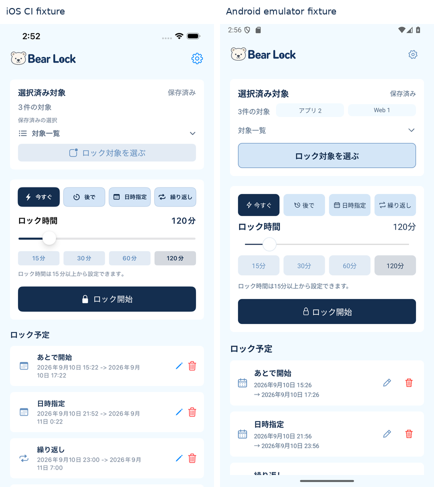
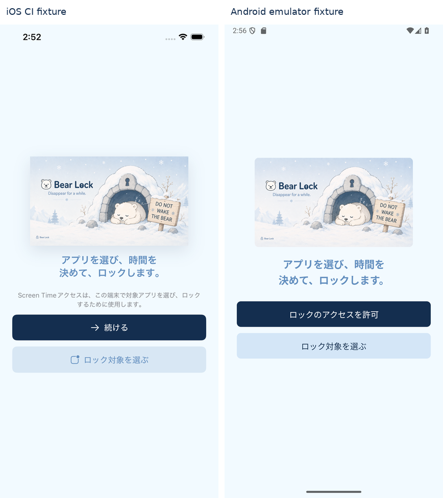
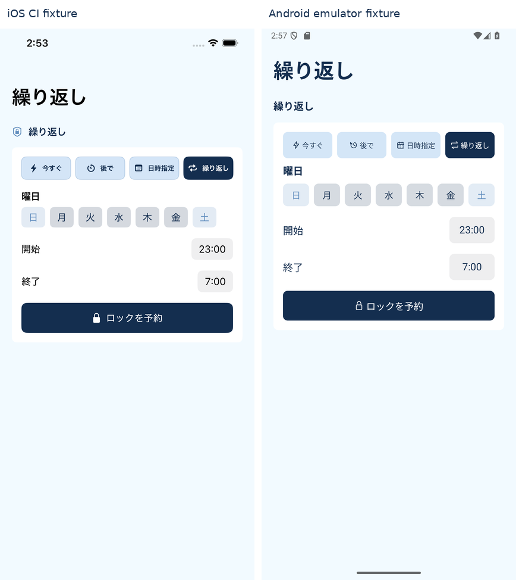
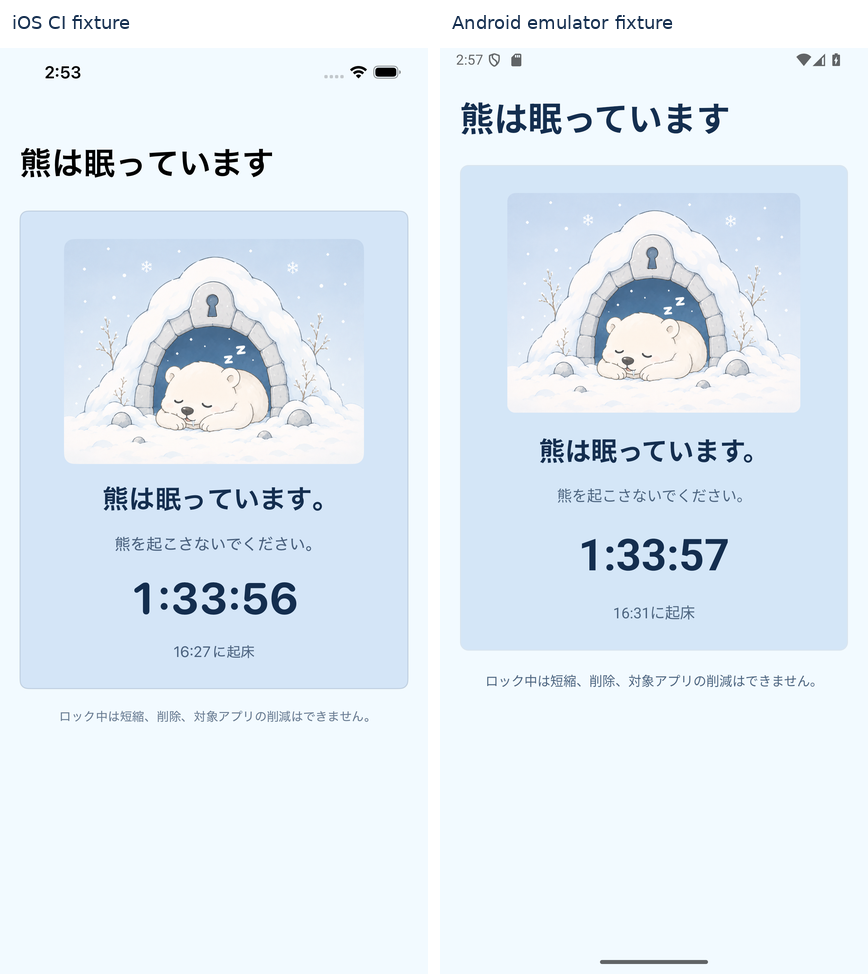
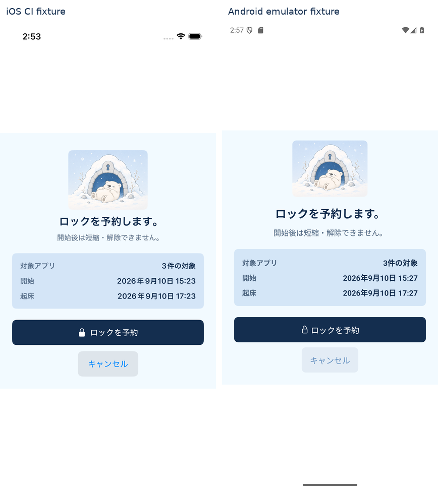
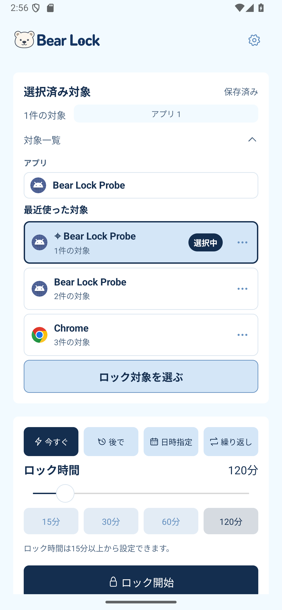
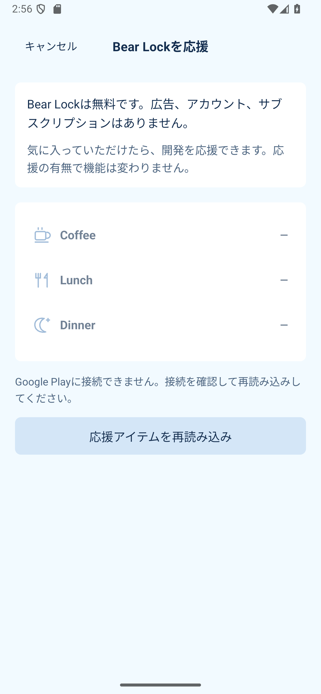

# AndroidをiOSに合わせる対応（2026-09-10）

> 過去の調査・実装・比較の記録。現行の製品仕様・OS別方針・構造は [設計正本](design-doc.md) に集約済み。本書の当時の目標や案を、現行の仕様・未採用案の実行指示として扱わない。

基準: iOSのmain `074223b` のSwiftUI/StoreKit実装。Android 0.2.0 / versionCode 4。

| ギャップ | 対応 |
|---|---|
| 対象一覧が長い文章 | アプリ・カテゴリ・Webごとのアイコン付き行。各グループ最大5行と「ほか○件」。アイコン取得はバックグラウンド |
| 履歴カードの内容・選択状態 | 代表アイコン・代表名・件数・選択中バッジ・選択枠。読み上げにも選択状態を付与 |
| 履歴の件数・並び・ピン上限 | ピン込み最大3件表示、ピン最大3件、ピン日時の古い順→通常履歴の使用日時の新しい順。保存履歴を削除しない |
| 既存データ | 旧形式を読み込み可能。既存の超過ピンは通常履歴へ戻し、対象と予約は保持。再利用でもピン日時を維持 |
| 押下反応 | 設定リンク・メニュー/編集アイコン・時間候補・曜日・時刻・キャンセルにリップル。対象の展開は局所更新と180msの遷移 |
| 確認画面 | 熊を112dpへ調整。情報欄の見出し/値をsemibold相当へ統一、キャンセルを中央の内容幅へ。文字拡大時の縦配置・スクロールは維持 |
| 設定 | 熊108dp・中央説明、アイコン付き共通項目、応援購入への遷移。Androidの権限・対応範囲・言語設定は維持 |
| 応援購入 | Coffee/Lunch/Dinner、Playの商品価格、保留/キャンセル/失敗/再接続、購入済み再照会、RSA署名検証、consumeと再試行 |
| 公開説明 | 日英Privacy/SupportにAndroidの端末内処理・権限と任意購入を追記 |

履歴は選択保存・確認キャンセルでは記録せず、ロック開始/予約の確定後に記録する。既存予約の編集・オンオフでも履歴を更新しない。

## 残る外部設定・検証

- **応援購入の配信設定とPlay上の購入試験は未完了**。ユーザー確認で商品・公開鍵が未設定。[商品IDと設定手順](android-support-purchases.md)。
- Pixel/Galaxy実機の長時間運用、全OS、最大表示サイズ、TalkBackの全経路は今回のエミュレーター確認だけでは保証しない。
- 起動検知後の遮断、ランチャーアイコン、Web/カテゴリ分類などOS固有の差は対象外。

## 画面・検証

スクリーンショットは `docs/qa/android-ios-parity-2026-09-10` に保存する。通常操作と読み取り専用フィクスチャを分ける。iOS比較画像は保存済みCI画像を固定し、公開中のiOSバイナリを今回再撮影したものではない。日時・対象内容・OS標準UI・フォントには差が残る。

ビルド: Debug APK / Release AAB / Release lint成功。単体20件成功（Planner 18件、購入署名検証2件）。エミュレーターで対象・予約の操作14件、追加受け入れ5件が成功。追加確認には日英、320dp幅・文字150%、未設定時の購入無効化と戻る操作を含む。

- [予約・履歴の操作結果](qa/android-ios-parity-2026-09-10/interactions.json)
- [追加受け入れ結果](qa/android-ios-parity-2026-09-10/acceptance.json)
- [ピクセル差分と元画像のSHA-256](qa/android-ios-parity-2026-09-10/pixel-diff.json)

### 日本語の比較（左iOS、右Android）

**ホーム**

[英語の比較](qa/android-ios-parity-2026-09-10/compare/en/home.png) · [赤色の差分](qa/android-ios-parity-2026-09-10/compare/ja/home-diff.png)

**初期設定**

[英語の比較](qa/android-ios-parity-2026-09-10/compare/en/setup.png) · [赤色の差分](qa/android-ios-parity-2026-09-10/compare/ja/setup-diff.png)

**繰り返し**

[英語の比較](qa/android-ios-parity-2026-09-10/compare/en/composeRepeat.png) · [赤色の差分](qa/android-ios-parity-2026-09-10/compare/ja/composeRepeat-diff.png)

**ロック中**

[英語の比較](qa/android-ios-parity-2026-09-10/compare/en/activeLock.png) · [赤色の差分](qa/android-ios-parity-2026-09-10/compare/ja/activeLock-diff.png)

**開始確認**

[英語の比較](qa/android-ios-parity-2026-09-10/compare/en/confirmation.png) · [赤色の差分](qa/android-ios-parity-2026-09-10/compare/ja/confirmation-diff.png)

ホームはAndroidの対象内訳と操作領域のため縦方向に長くなり、予定の続きはスクロールで表示する。確認画面は構成・情報の強調・中央のキャンセルを揃えた。OSバー、フォント、日付、予約内容を含むピクセル差は日本語で7.7〜22.2%、英語で10.2〜25.6%。これは機能の一致率や品質スコアではない。

### 通常操作の画面

[設定](qa/android-ios-parity-2026-09-10/actual/ja/settings.png) · [320dp・文字150%の対象一覧](qa/android-ios-parity-2026-09-10/large-text/target-details.png) · [320dp・文字150%の応援画面](qa/android-ios-parity-2026-09-10/large-text/support-unconfigured.png)。拡大表示は縦スクロールを使用する。

実ロックの回帰確認も成功: 1分間のProbe入力を遮断し、自然期限後に入力が復帰、予約・実行中セッションが空になった。[ログ](qa/android-ios-parity-2026-09-10/probe-result.json)。初回の確認は試験用InstrumentationがProbeプロセスを終了させて開始前に停止したため、事前のUI取得後にAccessibilityを再接続する手順で再実行した。
