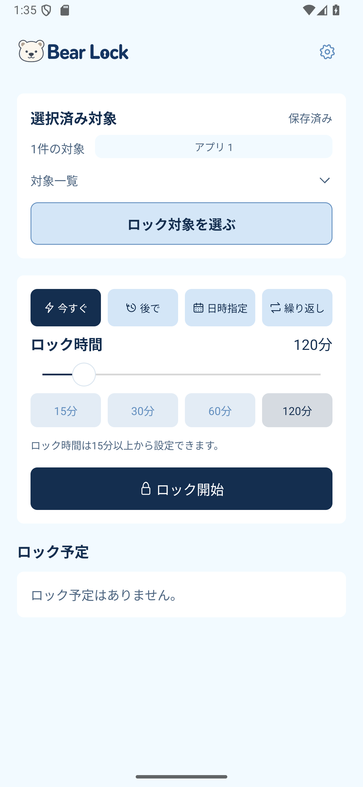
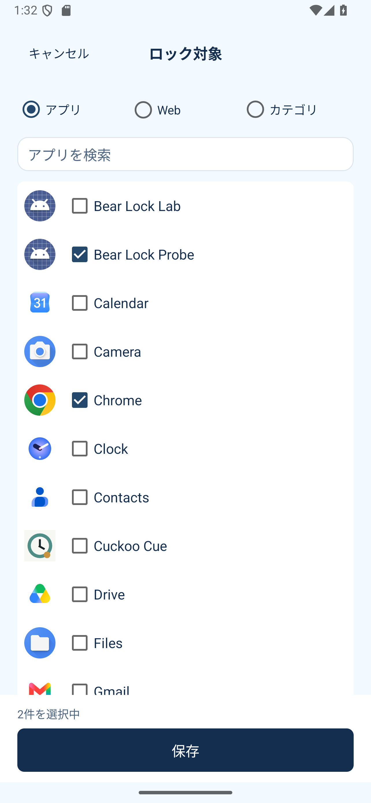

# Android 対象選択・履歴の修正（2026-09-08）

Android 0.1.2 / versionCode 3。

- 対象選択画面を先に表示し、アプリ・ラベル・アイコンの取得はバックグラウンドで行う。読み込み中もキャンセルと Web タブは操作可能。
- ホーム・電話アプリの除外一覧は、アプリごとではなく一覧取得ごとにまとめて問い合わせる。
- アプリ行は12件ずつフレームを分けて追加する。検索変更・タブ移動・画面退出後に古い結果を追加しない。同じ選択画面のカテゴリタブでは取得済みデータを利用する。
- 「ロック対象を選ぶ」は50dpの高さ、枠線、濃い太字、押下時のリップル表示に変更。
- 選択保存では履歴を追加・更新しない。確認画面でロック開始・予約を確定したときに記録する。キャンセル、既存予約の編集、オン・オフでは履歴を更新しない。同じ対象の再利用ではピンを保持する。
- iOS は `BearLockAppModel.createLock` 内で開始・予約が成功した後に履歴を記録している。`saveSelection` / `saveTargetSelection` は履歴を作成しないため、この不具合の修正は不要。

既存の履歴は保持する。過去に選択保存だけで追加された履歴は、実際に使用した履歴と識別できないため自動削除しない。

## 確認

- Debug APK ビルド、Release lint 成功。
- Planner 単体テスト16件成功（作成時の記録、編集時の維持、ピン保持、失敗時の維持を含む）。
- Pixel 9a エミュレーターで選択保存・キャンセル・予約確定・編集など14項目を確認。検索と文字150%の追加確認を含む結果は [result.json](qa/android-picker-fix/result.json) を参照。
- 実機での待ち時間の定量比較は未実施。アプリ一覧が揃うまでの時間はインストール数と端末に依存する。
- Play への配布は未実施。署名済み AAB は Android Internal Release の main から作成する。

## スクリーンショット（実際の操作画面）

| 選択ボタン | アプリ一覧 |
|---|---|
|  |  |

[検索結果](qa/android-picker-fix/search.png) · [文字150%・幅320dp](qa/android-picker-fix/home-large-text.png)

再現スクリプトは `android-lab/scripts/product_ui_parity_verify.py` と `product_picker_verify.py`。両方に `BEARLOCK_QA_OUT=artifacts/android-picker-fix` を指定してこの順で実行する（Debug製品・Probe APK を入れた QA エミュレーター向け）。
