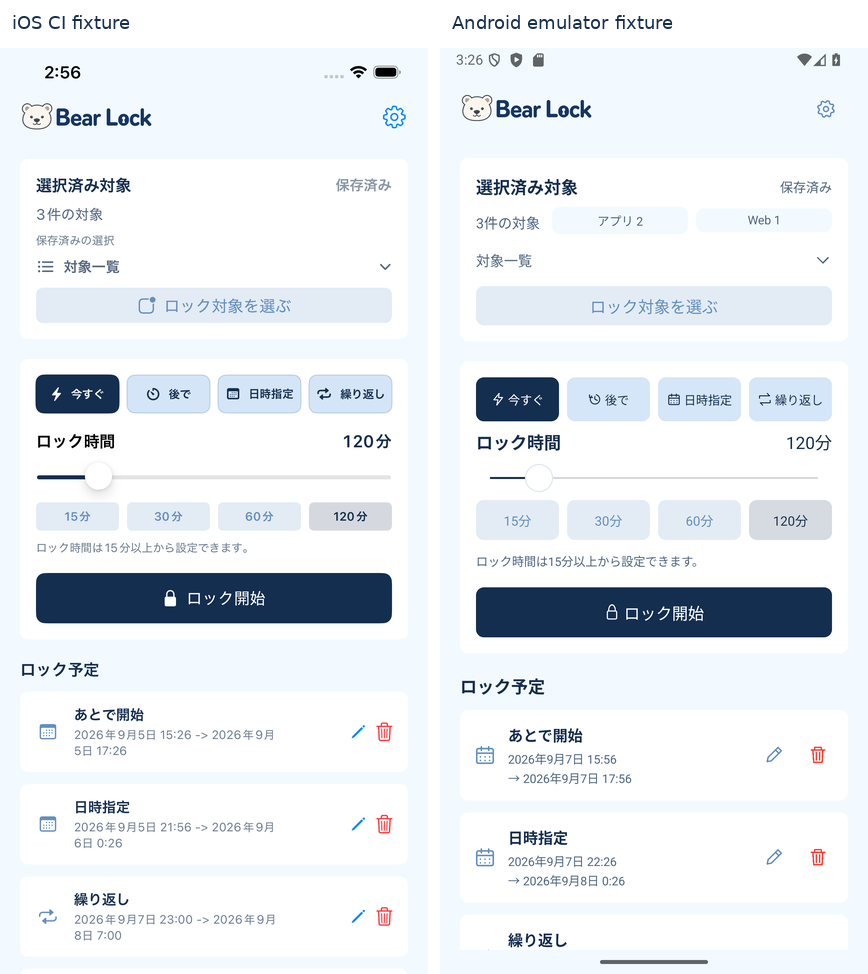
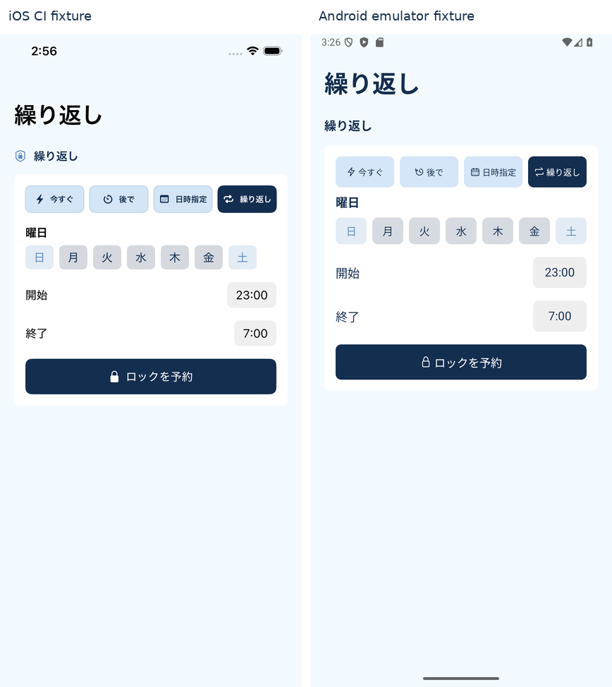
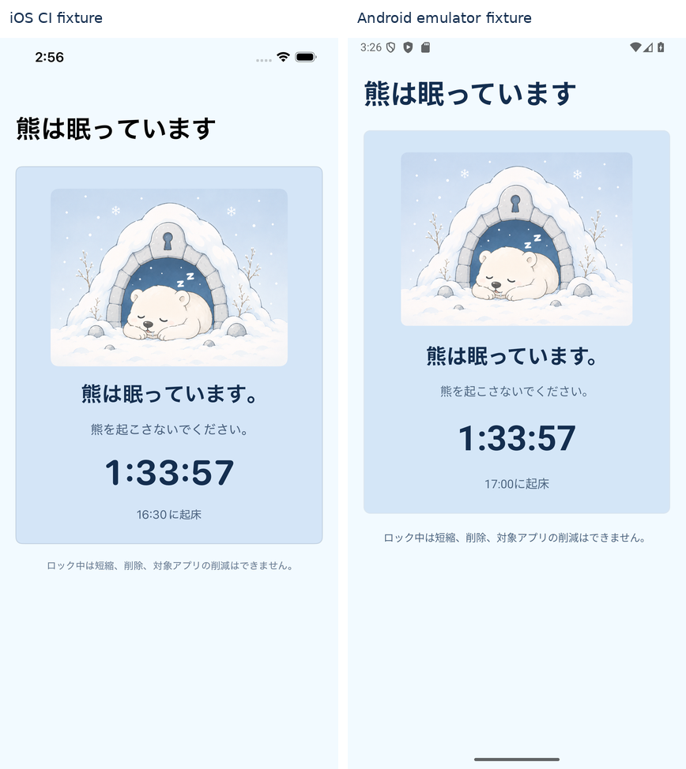
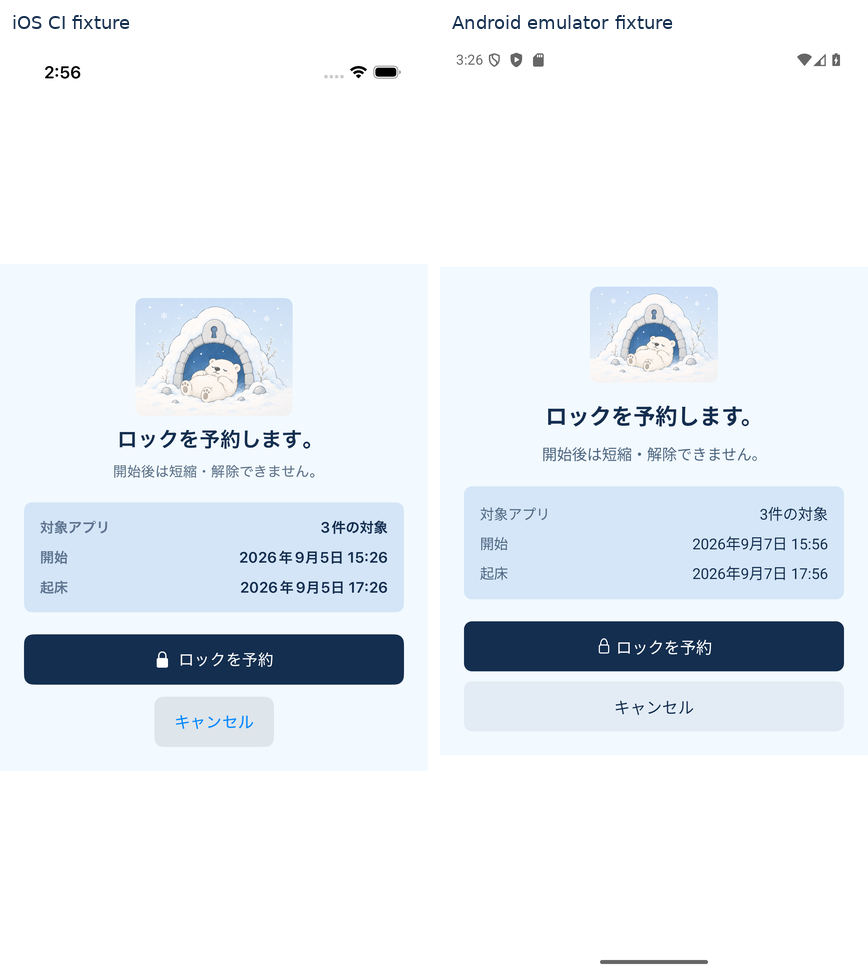

# Android UI修正とiOS比較（2026-09-08）

[レビューの17項目](android-ui-review-2026-09-08.md)を修正。Android版は0.1.1 / versionCode 2。

## 変更内容

| レビュー項目 | 対応 |
| --- | --- |
| UI-01 | 対象の総数と内訳を標準幅で同じ行に配置。0件の内訳を省略し、文字拡大では縦に並べる |
| UI-02〜03 | モードのアイコンと文字を一緒に中央配置。英語の日時指定はDateに短縮。小画面は2列 |
| UI-04 | 保存状態・内訳・時間値・プリセットの太字を減らし、見出しとの強弱を分ける |
| UI-05 | 対象一覧の右端に開閉アイコンを配置。行全体で開閉 |
| UI-06 | スライダーの内側余白を明示し、つまみの半径に合わせる。上下の操作領域を確保 |
| UI-07 | 時刻入力の見た目を44dpの最小高さと共通余白へ調整 |
| UI-08 | ロック中の説明と残り時間の間隔を広げ、起床時刻を補助色に変更 |
| UI-09 | 確認表の文字・行間を整理し、キャンセルに淡いボタン背景を付ける |
| UI-10 | 歯車を描き直し、操作アイコンの線幅・寸法を整理。鍵アイコンを文字中央へ揃える |
| UI-11 | 件数を固定3等分しない。文字拡大時に項目を縦配置し、単語途中の改行を回避 |
| UI-12 | モードとプリセットの横スクロールを撤去。小画面・文字拡大では2列で全選択肢を表示 |
| UI-13 | ヘッダーの左右領域を対称にし、タイトルを中央へ。文字拡大時はタイトルを操作行の下に分離 |
| UI-14 | 設定の熊を小さくし、説明を短い左揃えの文章へ変更 |
| UI-15 | 対象選択の件数は固定フッターに集約。アプリごとのカード間隔をなくし、一覧表示へ |
| UI-16 | モードと開始までの時間は作成カード内を更新。曜日・時間候補はその場で更新。画面の再構築が必要な場合も同じページのスクロール位置を復元 |
| UI-17 | 確認シートを内容に合わせた高さにし、画面高の90%を上限にスクロール可能にする。文字拡大時は確認表を項目名→値の縦配置にする |

予定日時は開始と終了を別行にして、長い日時が同じ行で競合しないようにした。時間候補・スライダー変更時の起床時刻もその場で更新する。

## スクショ

以下の比較は左iOS、右が今回のAndroid。iOSは以前の比較時に固定保存したCI画像、Androidは今回撮影のDebug表示フィクスチャ。日時・対象内訳・OSバーには差がある。完全なピクセル一致や実機の動作証明ではない。

### ホーム

### 繰り返し

### ロック中

### 確認

[英語ホーム](qa/android-ui-refresh/compare/en/home.png)・[セットアップ](qa/android-ui-refresh/compare/ja/setup.png)・[設定](qa/android-ui-refresh/android/ja/settings.png)

## 実際の操作と文字拡大

[対象選択](qa/android-ui-refresh/interactions/targets-apps.png)・[実確認シート](qa/android-ui-refresh/interactions/confirmation-sheet.png)・[予約編集](qa/android-ui-refresh/interactions/scheduled-editor.png)

[320dp・文字150%ホーム](qa/android-ui-refresh/large-text/home.png)・[繰り返し](qa/android-ui-refresh/large-text/repeat-controls.png)・[設定](qa/android-ui-refresh/large-text/settings.png)・[対象選択](qa/android-ui-refresh/large-text/targets.png)・[確認シート](qa/android-ui-refresh/large-text/confirmation.png)・[横向き確認シート](qa/android-ui-refresh/large-text/confirmation-landscape.png)・[長い対象名](qa/android-ui-refresh/large-text/confirmation-long-target.png)

[操作の録画](qa/android-ui-refresh/acceptance/stability.mp4)・[配置検証結果](qa/android-ui-refresh/acceptance.json)・[保存／編集／削除の検証結果](qa/android-ui-refresh/interactions/result.json)

## 検証条件

Pixel 9aエミュレーター / Android 15 API 35。標準1284×2778・density 480、拡大時960×2082・文字150%、横向き2082×960。比較画像は同じ製品UI部品を使う読み取り専用フィクスチャ。interactionsとlarge-textは通常画面の操作記録。

実機の全メーカー、TalkBack全操作、全ての長さの対象名を検証したという意味ではない。既存のAndroid製品版TODOの端末・権限・配信検証は継続する。

単体テスト14件、Release lint、Debug APK・Release AABのビルドが成功。通常UIの保存・編集・取消など12項目、配置・文字拡大の追加検証8項目が成功。[ビルドログ](qa/android-ui-refresh/build.log)・[単体テスト結果](qa/android-ui-refresh/planner-tests.xml)。

今回のローカルRelease AABは署名用Secretsを使用していない。配布にはmainのAndroid Internal Releaseを新規実行して署名済みAABを取得する。PlayでversionCode 2が既に使用済みなら、さらに大きい値へ変更する。リモートCIとPlayへの配信は今回未確認。

再現用スクリプト: `product_ui_parity_verify.py`（既存の保存・編集操作）、`product_ui_refresh_verify.py`（配置・文字拡大・撮影）、`product_ui_long_text_verify.py`（長い対象名）。今回の保存・編集操作は出力先のみ `artifacts/android-ui-refresh/interactions` に変更して実行した。比較図は `android_screenshot_diff.py --directory docs/qa/android-ui-refresh` で生成する。
