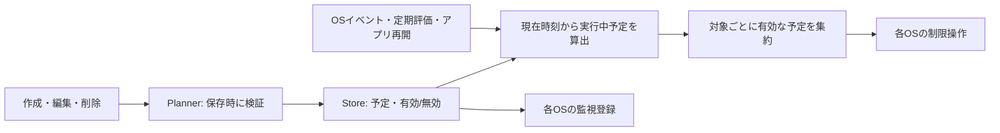

# Android / iOS ロック判定の統一（2026-09-13）

## 合意した仕様

- 保存するロック情報は予定と有効／無効。実行中ロックは `開始 <= 現在時刻 < 終了` から算出する。
- 単発予定は終了後も残す。端末時刻を期間内へ戻した場合の再ロックを許容する。完了履歴による再実行抑止は廃止する。
- 繰り返し同士の重複を許可する。対象は実行中予定の和集合。同じ対象に複数の予定が有効なら、最後の終了時刻まで制限する。
- 単発予約の1年上限を廃止し、8日より先の予約も次のアラーム候補に含める。繰り返しだけは次の週を探索する。
- 単発同士・単発と繰り返しの時間重複は引き続き拒否する（対象が異なっていても拒否）。
- 繰り返しは保存したタイムゾーンの開始・解除時刻を守る。夏時間切替日は経過時間が変わる。存在しない開始時刻は差分だけ繰り下げ、存在しない終了時刻は次の有効時刻、重複時刻は最初の時刻とする。これは現在の iOS Calendar の扱いに合わせたもの。
- 実行中の予定は編集・無効化・削除できない。開始前に開いた編集画面でも、保存時に最新の予定と時刻で拒否する。キャンセルで予定は変わらない。
- 読み取り失敗で空の予定を保存しない。解除のための状態書き込みは不要。失敗したOS操作は次の呼び出しで同じ予定から再計算する。

## 状態とモジュール



保存する状態は有効／無効の2つ。待機・実行中・終了は現在時刻から得る表示上の分類で、遷移を書き込まない。Androidの前面アプリ、表示中View、最後に読み取った予定は実行時の情報として残す。これらを予定・完了履歴と重複して永続化しない。

## 変更箇所

| 箇所 | 変更 |
| --- | --- |
| `Planner.kt` / `State` | `sessions`・`completed`・`reconcile` を廃止。`activeLocks` / `blockingLock` に判定を集約。DST、重複、実行中の編集禁止をiOSに統一 |
| `Store.kt` | 予定と対象履歴だけ保存。読み取り失敗を呼び出し元へ返し、ログ保存失敗が本処理を止めないよう変更 |
| `GuardService.kt` | 保存済み実行状態の更新を廃止。取得済み予定と現在時刻から遮断／解除を判断。読取失敗時は最後に読めた予定を保持 |
| `BoundaryReceiver.kt` | アラーム更新前の取消を廃止。同一PendingIntentで更新。登録失敗でもGuardを再評価し、画面に失敗・再試行を返す |
| `Shield.kt` | 除去に失敗した、まだ接続中のViewを保持して次の呼び出しで再試行。除去失敗後の二重追加を防ぐ |
| `MainActivity.kt` / `Composer.kt` / `HomeComponents.kt` | 実行中の繰り返しを一覧に残して編集・削除を無効化。編集画面も開始時に無効化。保存時刻はStoreの排他区間内で取得。保存後の監視失敗に再試行を用意 |
| テスト・CI | Swift/Kotlin共通の22件の時刻・対象データ、Androidの保存・OS操作失敗テスト、既存E2Eの保存形式対応 |

## OS固有として残すもの

| 項目 | iOS | Android |
| --- | --- | --- |
| 制限の実体 | ManagedSettings の shield | AccessibilityService の前面アプリ／URL検出とオーバーレイ |
| 実行のきっかけ | アプリ／DeviceActivity／Shield拡張の呼び出し | Accessibilityイベント、サービスの定期評価、アラーム、再起動・時刻変更等 |
| 保存の排他 | 別プロセスから読むためファイルロック | 現在は同一プロセスなので共有ガード＋AtomicFile。サービスを別プロセス化する場合は見直す |
| 監視登録 | DeviceActivity登録との照合 | 次の境界を同一PendingIntentで置換。監視済み状態の別保存は追加しない |
| 時刻精度 | DeviceActivity用に秒へ丸める | ミリ秒。開始・終了の包含規則は同じ |
| Web対象 | Screen Timeの対象トークン | 対応ブラウザーのアドレス表示を読むため、対応範囲は同一ではない |

SwiftとKotlinの製品コードを共通ランタイムへ移す変更はしていない。純粋な判定仕様と期待値を共有し、上記OS操作を各実装に残す。Androidのサービス未接続・停止中に常時実行できるという保証は追加していない。最後に読めた予定がある場合は、それを使って終了を判定できるが、起動直後から読めない場合に最新の制限対象を復元できるわけではない。

アラームの置換前にアプリ側で取消を行わないことで失敗時の空白を減らすが、OS内部の登録失敗で旧アラームが必ず保持されるとは保証しない。再試行は保存後の画面、アプリ再開、サービス接続、境界等から行う。

## テストの実行方法

```sh
swift test
ANDROID_HOME=/home/hiroyoshii/Android/Sdk ./android-lab/gradlew -p android-lab \
  :product:testDebugUnitTest :product:assembleDebug :product:assembleRelease :product:lintDebug :probe:assembleDebug
adb shell am instrument -w com.hiyozoo.bearlock/.LockInstrumentation
ADB=adb ANDROID_SERIAL=emulator-5554 BEARLOCK_QA_WITHOUT_EXACT_ALARM=1 \
  BEARLOCK_QA_SLEEP_THROUGH_EXPIRY=1 python3 android-lab/scripts/product_verify.py
```

`Tests/ContractFixtures/lock-contract.tsv` は両言語が直接読む期待値。タイムゾーン・境界・日またぎ・時刻巻き戻し・重複対象・夏時間の欠落／二重時刻を含む。native instrumentationは隔離したcache配下の保存領域で読取破損／書込失敗／ログ失敗を起こす。WindowManagerの除去失敗は注入したテスト用実装で再試行を検証する。実際の画面による遮断・自然解除はprobe E2Eで別に検証する。

ローカルではSwift 54テスト（Linux）、Android 26テストが成功。共通データは22件。AndroidのDebug APK、Release APK／AAB、lint（0 errors、15 warnings）が成功。native instrumentationの破損読取・AtomicFile書込失敗・ログ失敗・アラーム失敗後の再評価／再試行・View除去再試行も成功した。

Android 14エミュレーターでは、重複する繰り返しの実行中の編集／削除禁止、最初の期限後の遮断維持、最後の期限で本体を開かずに解除、終了後の編集／削除の再有効化、制限評価で保存ファイルが変化しないことを確認。既存の権限説明、対象選択の保存／取消、予約確認の取消、遅延予約の作成／編集／削除、通常の単発自然解除も成功した。正確なアラーム権限なしの通常／消灯中の期限経過についても、Bear Lock本体を開かずにProbeのタップが復帰することを確認した。

GitHub ActionsのAndroid CIは共通データ変更でも起動し、Android 14 Acceptanceは上記nativeテストと既存の通常・正確なアラーム権限なし・画面消灯中の自然解除試験を実行する。ローカル実行の合格とGitHub上の実行成功は別に扱う。この作業環境のGitHub CLIは未認証のため、GitHub上の実行結果は未確認。

## テスト版データと実機での残確認

移行は実装しない。Android保存スキーマは2に変更したため、旧テスト版からはアプリデータ消去／再インストールが必要（予定・対象履歴も消える）。旧データを読み取れない場合に勝手に上書きする救済処理は追加しない。ファイル名は既存の `locks-v1.json` のまま、形式は内部のschema値で判定する。

- iOS: 配布ビルドで長時間消灯→期限経過→対象アプリを開く。本体を開く前の解除を確認する。拡張が呼ばれるタイミングとScreen Timeの実際の解除はSwift unit testでは保証できない。
- Android: 複数メーカーの実機で長時間消灯／Doze／省電力設定／サービス再接続／再起動後の遮断と期限解除を確認する。エミュレーターの消灯試験はメーカー固有の停止動作を再現しない。
- 両方: 重複する繰り返しの先の期限で解除されず、最後の期限で解除されること、時刻巻き戻し時の再ロック、タイムゾーン変更時にも保存した地域の時刻が使われることを配布ビルドで確認する。
