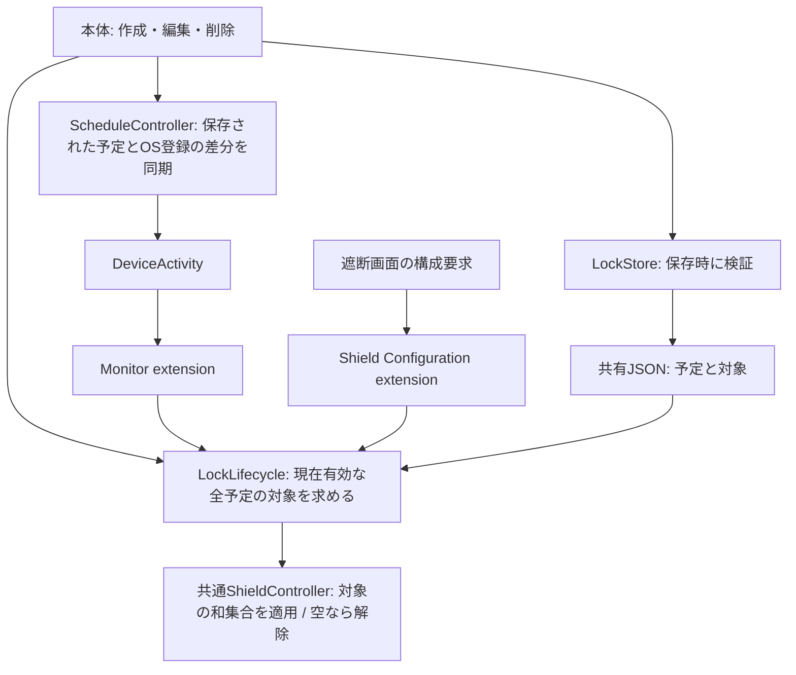
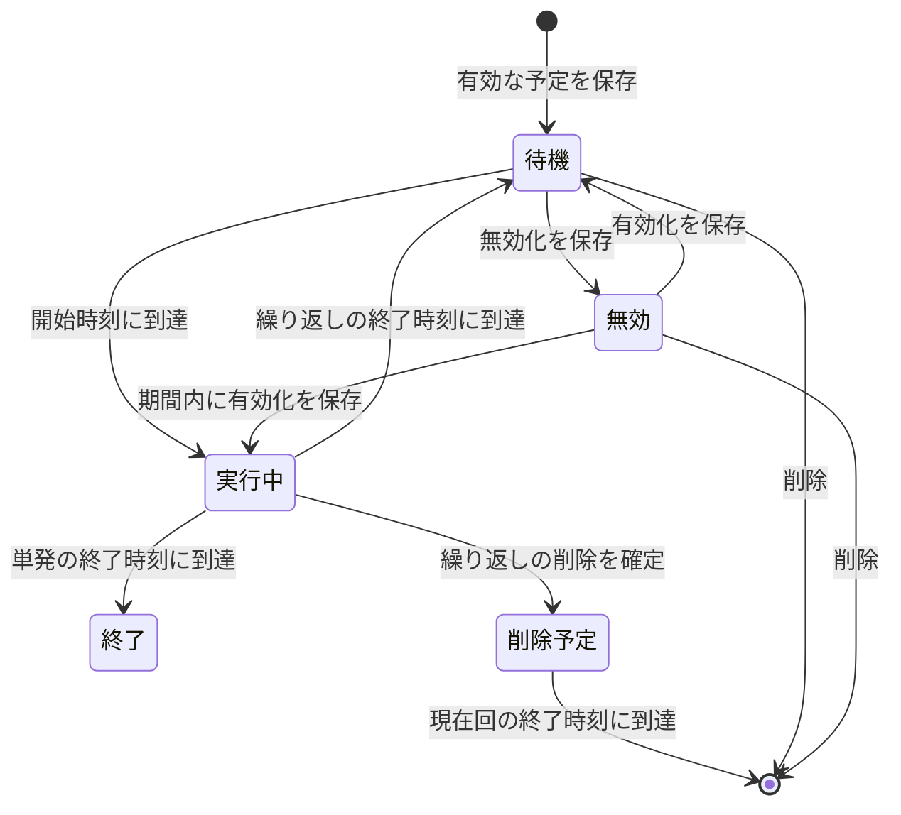

# iOS ロック判定の再構成と検証

予定型の分離・対象保存／編集状態の整理は [Android / iOS ロック判定の統一](android-ios-lock-contract.md) を参照。実行中の繰り返し削除については、iOSは2026-10-11から本書の削除予約仕様を正とする。

## 今回の範囲

保存するロックの正本を `LockState.rules` と対象データに一本化した。実行中かどうかは現在時刻から求める。Androidは変更しない。

報告された実機で何が起きたかは未特定。今回の変更は判定・保存・監視登録の整理であり、OSのcallback配信やShield Configurationの再実行を保証するものではない。旧データ・旧監視の移行は実装しない。ユーザーテスト中のため、旧ビルドから検証するときはアプリとその制限をリセットして予定を作り直す。

## 残すもの・削除するもの

| 項目 | 変更後 |
|---|---|
| `rules`、対象のtokenData、対象の再利用履歴 | 維持。対象の再利用履歴はロック実行履歴とは別の機能 |
| `activeLock` / `completedLocks` の保存 | 削除。`activeLocks(at:)` で現在の予定から計算 |
| 実行状態側の終了時刻 | 削除。対象となる予定の発生期間の終了時刻だけを使用 |
| 予定の `.completed` | 削除。有効・無効と、繰り返しの削除予約時刻だけを保存。単発の終了は時刻で判定 |
| callback種別・rule ID・過去の完了履歴による解除可否 | 削除。自分の監視callbackを入口として、最新の全予定を評価 |
| 実行中の繰り返し予定の編集・無効化 | 禁止。画面と保存時の両方で判定 |
| 実行中の繰り返し予定の削除 | 現在回の終了時刻を `scheduledDeletionAt` に保存。現在回は維持し、次回以降を無効化 |
| 親予定の削除後も実行中ロックを残す処理 | 同じルールと削除予約時刻から算出。独立した実行中スナップショットやタイマーは追加しない |
| `ActiveLock` 型 | 画面表示用として維持。予定ID、開始、終了、対象から生成。保存しない |
| JSON repository、ファイル保護、プロセス間の排他 | 維持。読込・判定・shield適用を同じ排他区間で処理 |
| 既存診断ログ | 維持。Shield Configurationの重複loggerは共通loggerに統合。新しい診断基盤は追加しない |

## 変更量（実測）

比較元は `b59e44d`。今回変更したSwiftファイルの物理行数。新規ファイルは変更前0行、削除ファイルは変更後0行として集計。テスト・文書・設定を本体コードの削減量に含めない。

| 区分 | 変更前 | 変更後 | 差分 |
|---|---:|---:|---:|
| 本体モデル | 634 | 525 | -109 |
| 画面・表示fixture | 1349 | 1368 | +19 |
| extension | 325 | 143 | -182 |
| サービス | 211 | 199 | -12 |
| テスト | 1538 | 1497 | -41 |
| 共有ロジック | 917 | 752 | -165 |
| 本体コード計 | 3436 | 2987 | **-449** |

## モジュールと状態

待機・実行中・終了は現在時刻から求める。実行中の繰り返しは編集・無効化できないが、削除を確定すると現在回の終了時刻だけを削除予約として保存する。その時刻まではロックを維持し、到達後は次回分を生成せず、本体の次回読込時にルールを除去する。終了前は削除予約を取り消せる。取り消しによって別の単発予定と競合する場合は拒否し、削除予約を維持する。

## 判定と失敗時の処理

- 開始を含み終了を含まない期間、`start <= now < end` を使用。遅れて呼ばれても終了時刻を動かさない。
- 現在有効な予定の対象集合を合成。古い予定の終了callbackが来ても、別の実行中の対象を消さない。同じ対象の重複は一度にまとめる。
- Shieldの時刻表示も、その対象に該当する現在の予定から求める。複数該当時は最も遅い終了時刻を表示する。
- 判定は実行履歴を書かない。保存失敗が解除処理の前提条件にならない。データの読込失敗・実行中の対象データ欠損はエラーとし、不完全な対象集合を適用しない。
- 正常に空状態を読めた場合は残っている制限を解除する。App Groupにアクセスできない場合を空状態として扱って制限を変更しない。
- 本体は予定保存→監視同期→shield再評価の順に実行。監視登録に失敗しても、保存済み予定を取り消さない。登録失敗を表示し、次の本体再表示または予定操作で同期を再試行する。保存済みの場合は編集画面を閉じ、二重作成を防ぐ。
- 監視同期が失敗しても期限の再評価は実行する。個別の監視登録が失敗しても他の登録を試す。再試行ではOSに残っている同一登録を再登録しない。
- 監視同期はLockStore actor内で最新予定を読み直し、本体の保存処理と直列化する。OS監視のstart/stop中は共有JSONの排他を保持しない。同期callbackによる待ち合わせを避ける。
- 登録済みの古い時刻がOSに残る失敗はあり得る。そのcallbackでも解除・適用の判定には保存済みの最新予定を使う。ただし、登録されなかった時刻に新たなcallbackが来る保証はない。本体を開くまで再登録できない場合がある。
- 繰り返し監視には曜日・時刻・timezoneを登録し、初回の日付を含めない。日またぎと夏時間でも予定の終了時刻に合わせる。単発監視の秒単位の正規化は維持。

## 自動検証

実施済み（WSL / Swift）:

- `swift test`: 70件成功。開始・終了境界、遅延・重複呼出し、長時間後、日またぎ、翌週、重複対象、読込・保存・適用失敗、保存時の変更禁止、繰り返し削除予約の永続化・期限反映・取消時の競合・起床との併用、登録差分の部分失敗と再試行、夏時間、古い単発予定の重複判定など。
- `python3 Scripts/test-lock-repository-processes.py`: 4つの独立プロセスからの保存200件を欠落なく確認。
- 変更したiOS Swiftファイルの構文解析、YAML解析、`git diff --check`。

GitHub Actionsの `iOS Lock Lifecycle` に用意した検証（今回の実行結果は未確認）:

1. 上記のSwiftテストと独立プロセスのテスト。
2. `BearLockLogicTests`。本体に本物のLockStoreと失敗する監視adapterを接続し、保存成功後の登録失敗・再試行、保存失敗、期限切れ解除、実行中の変更禁止、実行中の削除予約を確認。
3. 本体と全extensionのDebug/Release Simulatorビルド、スクリーンショット用アプリのビルド。
4. mock UIテスト。入口・権限復旧・即時作成・予約編集削除・実行中の操作制限に加え、実行中の繰り返し削除が予約表示になり、取消・再予約ができ、再起動後も現在回を維持することを確認。

`iOS CI` にも追加した2つの画面テストと実行中の繰り返しのスクリーンショット収集を含めている。

## 実機確認（未実施）

署名・Family Controls entitlementのある新ビルドで実施する。各手順では、対象アプリが使えるかを**Bear Lockを開く前に**確認する。

| ケース | 操作と確認 |
|---|---|
| 長時間スリープ | ロック開始後に画面を消し、終了時刻を十分過ぎてから対象アプリを開く。Bear Lockなしで解除されるか |
| 画面オンで期限通過 | 別アプリを使用して期限を越え、対象アプリが使えるか |
| 開始中・終了後に初めて端末を使用 | 予約前にスリープし、期間内または終了後に端末を使う。遅い開始で終了が延びたり、終了済み対象を再ロックしないか |
| 次の繰り返し | 本体を開かず次回の曜日まで経過させる。開始・終了と日またぎを確認。週末の曜日折返しも含める |
| 実行中の操作禁止 | 実行中は時刻・曜日の編集と無効化ができず、単発ロックは削除もできないこと。繰り返しは削除確認のキャンセルで維持され、確定後も現在回の終了時刻までは制限が続き、その後の回だけが実行されないこと。終了前の削除予約取消と、競合時に予約が維持されること。他の予定の制限は残ること。編集画面を開いたまま開始時刻をまたいでも保存できないこと |
| 重なる繰り返し | 別対象・同じ対象の両方で確認。先の終了で後の対象まで解除されないこと |
| Shield Configuration経由 | 遮断画面の構成要求が本当に発生したか、共通判定とAPI適用まで進んだか、対象アプリが使えるかを分けて観察 |
| 強制終了・再起動 | 本体を強制終了した場合、再起動後の初回認証前後の場合を分け、共有ファイルの読込とOSの実行を確認 |
| 登録失敗から復旧 | エラー表示後に本体を開き直し、予定が増えず、実際のOS監視が再登録されること |

`DeviceActivity.intervalDidStart/End`、`DeviceActivity.reconcile`、`ShieldRecovery.reconcile`、`Lock.reconcile` と `Shield.apply/clear.requested` を既存ログで区別する。`requested` はAPI呼出しまでの記録であり、実際に遮断が外れた証明ではない。ログがないだけで未呼出しとも断定しない。

Shield ConfigurationはOSが構成を要求したときの入口であり、対象アプリを開くたびに必ず呼ばれるという前提を置かない。独立した常駐処理や時刻トリガーは追加していない。

参考: [DeviceActivityの終了callback](https://developer.apple.com/documentation/deviceactivity/deviceactivitymonitor/intervaldidend(for:))、[ShieldConfigurationDataSource](https://developer.apple.com/documentation/managedsettingsui/shieldconfigurationdatasource)、[ManagedSettingsのcategory policy比較](https://developer.apple.com/documentation/managedsettings/shieldsettings/activitycategorypolicy)。
