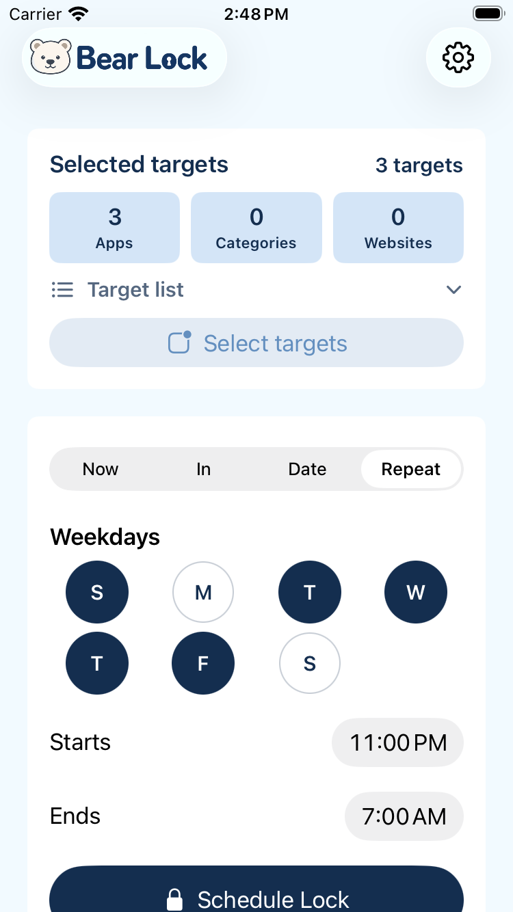
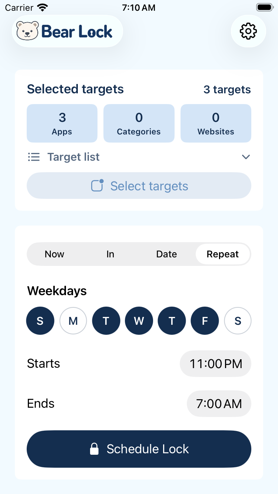
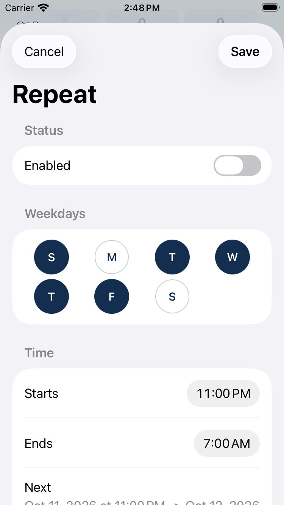
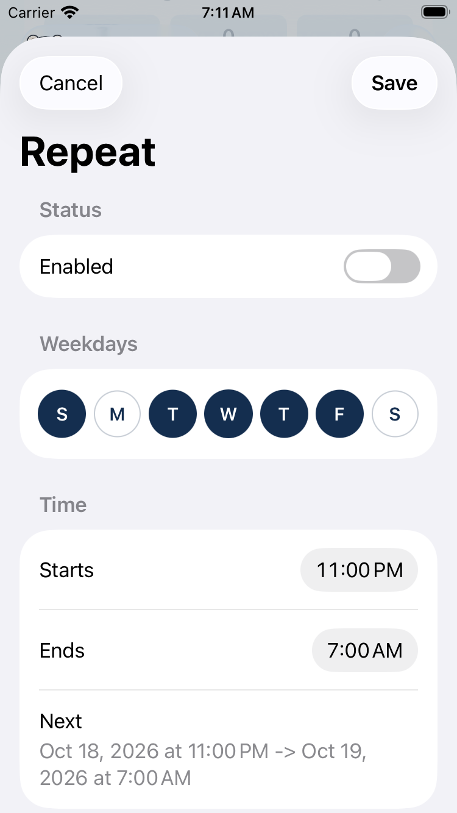
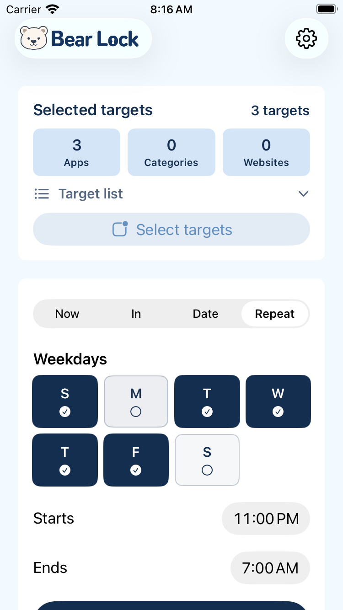
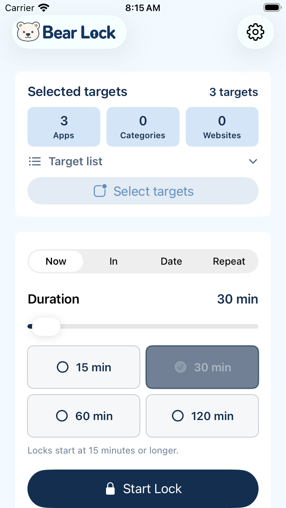
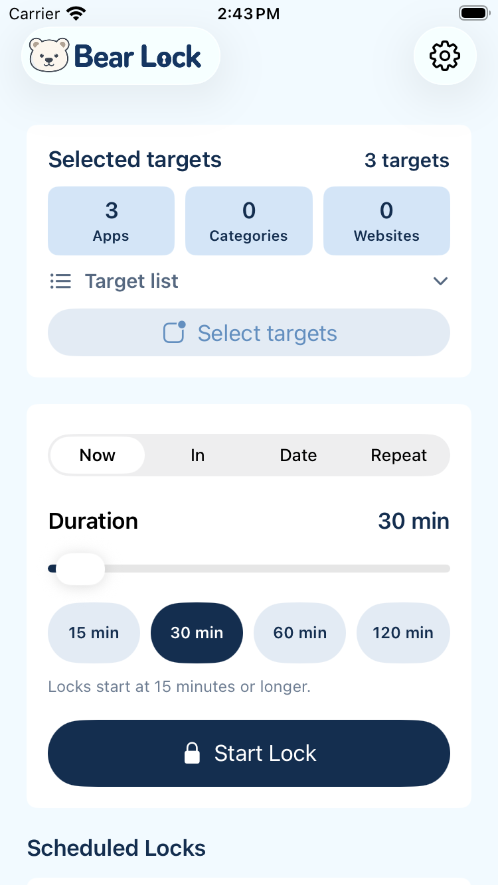

# iOS 選択状態UIの修正と評価

## 2026年10月18日 開始モードと曜日の外観を復元

チェック追加直前の `3cde327` を基準に、通常文字の開始モードを元のアイコン・配色・並びのボタンへ戻した。選択値は元のBindingのままで、選択traitと正式名称の読み上げ情報を追加した。通常セグメントと85ptの幅判定を撤去し、全文が実際に収まらない場合だけDateへ短縮する。今回の375pt・440pt・App Store用428ptの英語4択はDate、3択ではDate & Timeを確認した。詳細見出しと読み上げ名は全文のまま。大きい文字の標準メニューは変更していない。

曜日は同基準の非選択の薄灰背景・文字色・1pt枠へ戻し、選択中の2pt枠を撤去した。丸・チェックなし・7曜日横1列、矩形のタップ判定、文字拡大時の縦配置・正式名称は維持した。時間プリセット、ロック中の説明、確認シート、ロック・削除仕様は今回変更していない。

検証ソースは `4e9e3774c03d9259c3dc3bc71901cde20cb596f2`。[検証run](https://github.com/hiroyoshii/bearlock/actions/runs/39049336403)の結果は以下のとおり。成果物IDは通常 `12107788736`、StoreKit `12106918460`。

| 検証 | 結果 |
|---|---|
| 通常端末のE2E | 22件、失敗0。開始モード、プリセット、曜日編集、英語・日本語の最大文字サイズの一連の操作が成功。[生ログ](ios-selection-controls-2026-10-11/icon-restoration-2026-10-18/xcodebuild-ui-e2e.log) |
| SEのE2E | 4件中2件失敗。曜日の作成・編集・保存後の横1列判定と保存値、および操作不可状態のケースは成功。[生ログ](ios-selection-controls-2026-10-11/icon-restoration-2026-10-18/xcodebuild-selection-small-iphone.log) |
| AppModel・StoreKit | 9件・10件がそれぞれ失敗0 |
| Core・cross-process・ビルド | いずれも成功。Release・Debug・UIテスト・撮影アプリのビルドを含む |
| 最新ギャラリー | 日英各16枚、計32枚、1284×2778。全画像を目視し、同runの未加工PNGへ置換 |

**評価は、対象の通常時の外観復元を確認済み、全体E2Eは不合格。** SEの失敗は次の2件で、原因は未特定。これらの製品コントロール自体は今回変更していないが、今回の復元との因果も断定しない。再試行・スキップや追加のUI変更で成功扱いにはしていない。

- `testDurationPresetsAndModeReflectCurrentValue` の28行: 開始モード4択の存在・選択情報・操作領域・同一行の判定は成功した後、30分プリセットの1回のtap直後にselected traitがfalseだった。録画の[最終保持フレーム](ios-selection-controls-2026-10-11/icon-restoration-2026-10-18/se-duration-final.png)も120分表示のまま。単なるassertionの読み取り遅れとは断定しない。
- `testSelectionAtAccessibilityTextSizeInEnglishAndJapanese` の共通helper 564行: SE・英語・最大文字サイズでDate & TimeからRepeatへの切替がタイムアウトした。1回の200ms press後の[録画43秒のフレーム](ios-selection-controls-2026-10-11/icon-restoration-2026-10-18/se-menu-after-press.png)では、Date & Timeが選択されたメニューが開いたまま。SEの日本語の後半には到達していない。

前回の通常端末で失敗した実行中の説明文の期待値は、現在の繰り返し予定の文言へ修正した。最大文字サイズのネイティブメニューの操作方法は変えていない。CIのアクセシビリティ情報の確認と実機VoiceOverの音声操作は区別し、実機確認済みとはしない。

ライトモードの英語composeRepeat画像で、非選択の文字内部RGB `(82,101,125)` と背景 `(243,243,244)` のコントラストは約5.39:1、選択中の白と濃紺は約13.69:1。文字のアンチエイリアス端や押下中、OS設定全体の適合を示す値ではない。

今回直前のセグメント・白い非選択曜日からの比較（同じ375pt・同じ選択値）:

| 対象 | 今回直前 | 修正後 |
|---|---|---|
| 作成 | [セグメントと白い曜日](ios-selection-controls-2026-10-11/weekday-row-2026-10-17/selection-375-weekday-changed.png) | [アイコン付きボタンと薄灰の曜日](ios-selection-controls-2026-10-11/icon-restoration-2026-10-18/selection-375-weekday-changed.png) |
| 保存後の編集 | [白い曜日](ios-selection-controls-2026-10-11/weekday-row-2026-10-17/selection-375-weekday-editor-saved.png) | [薄灰の曜日](ios-selection-controls-2026-10-11/icon-restoration-2026-10-18/selection-375-weekday-editor-saved.png) |

通常幅の[作成](ios-selection-controls-2026-10-11/icon-restoration-2026-10-18/selection-440-weekday-changed.png)・[編集](ios-selection-controls-2026-10-11/icon-restoration-2026-10-18/selection-440-weekday-editor-saved.png)、SEの[開始モード4択](ios-selection-controls-2026-10-11/icon-restoration-2026-10-18/selection-375-duration-initial.png)、通常端末の最大文字サイズで保存後の[英語](ios-selection-controls-2026-10-11/icon-restoration-2026-10-18/selection-440-accessibility-en-editor-saved.png)・[日本語](ios-selection-controls-2026-10-11/icon-restoration-2026-10-18/selection-440-accessibility-ja-editor-saved.png)も保存した。以下は過去時点の記録であり、今回の全体E2Eの合格へ流用しない。

## 2026年10月17日 曜日の横1列を復元

前回は小型画面や編集Formの2列表示を許容して「復元範囲は合格」としたが、元の7曜日横1列を戻せていなかった。この点の合格判断を訂正する。直径の固定と4列グリッドへの折り返しは今回の修正で持ち込んだ変更であり、元のレイアウトを維持する条件が検証から抜けていた。

通常文字では固定幅と折り返しを撤去し、利用可能な幅を7等分するHStackへ戻す。標準文字サイズでの高さ44ptと従来の文字サイズに連動した拡縮、間隔8pt、丸・チェックなし・選択traitを保持し、アクセシビリティ文字サイズの縦配置と拡大した丸・正式名称は変えない。狭い画面の通常行だけは幅が44ptを下回るため、標準文字サイズの全曜日について幅28pt以上・高さ44pt以上・画面内・等幅・同じ中心Y・AX frameの非重複を検証する。28ptは[Apple Accessibilityのcontrol-size表](https://developer.apple.com/design/human-interface-guidelines/accessibility)のminimumであり、44ptのdefaultと混同しない。他の操作や大きい文字の44pt検証は維持する。

修正ソースは `dd83005acfbce2f52058710eba15eaabe036695a`。[検証run](https://github.com/hiroyoshii/bearlock/actions/runs/39010305244)で、既存の通常端末・SEのテスト経路に作成・編集・保存後の1列判定を追加した。曜日のケースは両端末で成功（通常70.165秒、SE72.377秒）。375pt・440ptの作成／保存後の編集の実画像でも、7曜日が横1列、丸・チェックなし、同じ保存値であることを確認した。最大文字サイズは引き続き縦配置とし、SEの英語・日本語の編集保存画像を確認した。今回のコード変更はWeekdayPickerと既存の曜日テストのみで、別のUI変更や再試行・スキップは追加していない。

評価: **曜日の1列復元は合格。ただし全体E2Eは未合格。** SEは4件すべて成功。通常端末は22件中2件失敗した。

- `testCreateAndOpenRecurringEditorWithMockServices`: 実行中の繰り返し予定で編集不可の分岐に入り、単発予定用の古い説明文を期待するassertionが失敗した（BearLockLaunchUITests.swift:352）。実装の現在の説明文は「削除は今回のロック終了時に反映」であり、期待文言と一致しない。このテストは今回変更していない。
- `testSelectionAtAccessibilityTextSizeInEnglishAndJapanese`: 英語の一連の操作後、日本語の最大文字サイズで「日時指定」へ切り替えた値の待機がタイムアウトした（共通helperのBearLockLaunchUITests.swift:564）。原因は未特定で、曜日の行配置の不具合とは断定しない。SEの同じテストは成功している。

Core、cross-process検証、AppModel 9件、StoreKit 10件、Release／Debugビルド、日英32枚のスクショ取得は成功。スクショ取得成功を全体E2Eの合格へ読み替えない。[通常端末の生ログ](ios-selection-controls-2026-10-11/weekday-row-2026-10-17/xcodebuild-ui-e2e.log)と[SEの生ログ](ios-selection-controls-2026-10-11/weekday-row-2026-10-17/xcodebuild-selection-small-iphone.log)を保存した。成果物IDは通常 `12093497281`、StoreKit `12093085952`。

今回のbeforeは前回「復元済み」とした2列の実画像、afterは今回runの実画像。過去の記録は書き換えず、repoの最新ギャラリーだけを今回の日英32枚へ置き換えた。以下の2026年10月12日の合格・最終runの記載は当時の記録であり、今回の全体合格を示さない。

| 対象（SE・375pt） | Before：前回残した2列 | After：7曜日横1列 |
|---|---|---|
| 作成 |  |  |
| 保存後の編集 |  |  |

通常幅の[作成](ios-selection-controls-2026-10-11/weekday-row-2026-10-17/selection-440-weekday-changed.png)・[編集](ios-selection-controls-2026-10-11/weekday-row-2026-10-17/selection-440-weekday-editor-saved.png)、最大文字サイズの編集保存後の[英語](ios-selection-controls-2026-10-11/weekday-row-2026-10-17/selection-375-accessibility-en-editor-saved.png)・[日本語](ios-selection-controls-2026-10-11/weekday-row-2026-10-17/selection-375-accessibility-ja-editor-saved.png)も同runから保存した。

## 2026年10月12日時点の記録

対象: 曜日、時間プリセット、開始モード、保存済み対象、ロック中の無効状態。
復元・検証ソース: `d068fe47a1bf31af11f0bcfb9470bba729e64e97`。[最終検証run](https://github.com/hiroyoshii/bearlock/actions/runs/38145820236)は全ジョブ成功。通常E2E 22件、SE E2E 4件、AppModel 9件、StoreKit 10件がすべて失敗0。以下の過去runの合格は復元後の合格に流用していない。

評価結論: 合意した復元範囲は合格。曜日の丸・チェックなし、時間プリセットの標準Button・通常1列、周辺操作の元の色を実画像で確認した。選択trait、操作領域、最大文字サイズの縦配置・スクロールと保存結果は維持している。アプリ全体のアクセシビリティ監査完了とはしない。

repoの最新ギャラリーは同runの日英32画像へ更新。[画像一覧](../../ci-screenshots/README.md)と[出典](../../ci-screenshots/app-store-source.json)を参照。更新・評価確定日は2026-10-12 JST（CIは2026-10-11 UTC）。

## Before / after の確認対象

比較元は `141c50739a1bc4424c499f90d05a3ad0a378f1b8`、run `38122710825` の実画像。比較後は本稿の最終検証runに限定する。

| 対象 | Before | After |
|---|---|---|
| 曜日・通常幅 | [角丸とチェック](ios-selection-controls-2026-10-11/before/selection-440-weekday-changed.png) | [丸と塗りつぶし](ios-selection-controls-2026-10-11/after/selection-440-weekday-changed.png) |
| 曜日・SE | [変更前](ios-selection-controls-2026-10-11/before/selection-375-weekday-changed.png) | [変更後](ios-selection-controls-2026-10-11/after/selection-375-weekday-changed.png) |
| 時間プリセット・通常幅 | [変更前](ios-selection-controls-2026-10-11/before/selection-440-duration-selected.png) | [変更後](ios-selection-controls-2026-10-11/after/selection-440-duration-selected.png) |
| 時間プリセット・SE | [変更前](ios-selection-controls-2026-10-11/before/selection-375-duration-selected.png) | [変更後](ios-selection-controls-2026-10-11/after/selection-375-duration-selected.png) |
| 最大文字サイズの時間 | [変更前](ios-selection-controls-2026-10-11/before/selection-375-accessibility-en-duration.png) | [変更後](ios-selection-controls-2026-10-11/after/selection-375-accessibility-en-duration.png) |
| 開始モード、＋／− | [変更前](ios-selection-controls-2026-10-11/before/selection-440-mode-delayed.png) | [変更後](ios-selection-controls-2026-10-11/after/selection-440-mode-delayed.png) |
| 予定編集・削除予約取消 | [変更前](ios-selection-controls-2026-10-11/before/e2e-active-recurring-deletion-scheduled.png) | [変更後](ios-selection-controls-2026-10-11/after/e2e-active-recurring-deletion-scheduled.png) |
| 日時入力・確認 | [日時入力](ios-selection-controls-2026-10-11/before/selection-375-accessibility-en-times.png)、[確認](ios-selection-controls-2026-10-11/before/selection-375-accessibility-en-confirmation.png) | [日時入力](ios-selection-controls-2026-10-11/after/selection-375-accessibility-en-times.png)、[確認](ios-selection-controls-2026-10-11/after/selection-375-accessibility-en-confirmation.png) |
| 保存済み対象・無効理由 | [対象](ios-selection-controls-2026-10-11/before/e2e-target-flow-recent-selected.png)、[無効理由](ios-selection-controls-2026-10-11/before/selection-375-locked-target-explanation.png) | [対象](ios-selection-controls-2026-10-11/after/e2e-target-flow-recent-selected.png)、[無効理由](ios-selection-controls-2026-10-11/after/selection-375-locked-target-explanation.png) |
| 編集保存・再表示 | [変更前](ios-selection-controls-2026-10-11/before/selection-375-weekday-editor-saved.png) | [変更後](ios-selection-controls-2026-10-11/after/selection-375-weekday-editor-saved.png) |

途中の不合格画像は `rejected-*` に分離した。上記afterは最終runの合格と目視確認後の実画像であり、先行runや合成画像を混ぜていない。

主要2箇所の比較（375pt、同じ選択状態）:

| 対象 | Before | After |
|---|---|---|
| 曜日 |  |  |
| 時間プリセット |  |  |

## 原因と経緯

- `05e9e60` は曜日の状態を通常の `.bordered` Buttonのtint変更だけで表した。作成・編集に同じコードが重複し、選択状態のアクセシビリティ情報がなかった。
- `156fe49` は時間プリセットに同じパターンを追加した。
- `abe7857` は開始モードを標準のsegmented Pickerから自作Button群へ変更した。視覚表現だけを補い、選択状態の意味情報を引き継がなかった。
- 9月12日の[利用フローレビュー](cross-platform-ux-review-2026-09-12.md)でUX-15（曜日・プリセットの色依存、選択状態・分単位の読み上げ欠落、確認画面のスクロール不足）とUX-17（選択表現の不一致）は既に指摘されていた。指摘の記録が修正・確認まで結びついていなかった。
- 従来のE2Eは操作・保存の結果を中心に確認し、状態の見え方・意味情報を完成条件にしていなかった。スクショ保存だけではこの欠陥を検出できない。

根本原因は、選択コントロールに必要な標準の意味・見た目を実装時の要件にせず、個別Buttonの装飾で代用し、レビューで指摘済みの問題も修正・再検証まで閉じなかったこと。コード上は状態をtintへ直接埋め込む作りが同種の問題の横展を容易にした。履歴から実装・検証の不足は確認できるが、実装者個人の知識水準までは断定できない。

判断基準は[Apple HIG Accessibility](https://developer.apple.com/design/human-interface-guidelines/accessibility)の色以外の状態指標・操作領域・文字拡大と、[Focus and selection](https://developer.apple.com/design/human-interface-guidelines/focus-and-selection)のプラットフォームと整合する選択表現。デザイントークン新設を問題の解決策にはしていない。

## 修正内容と横展

| 対象 | 対応 |
|---|---|
| 曜日・作成／編集 | 共通のWeekdayPickerを使用。元の丸いボタンに戻し、チェックを削除。選択中は濃紺の塗りつぶし、非選択は白地と枠線。選択traitと曜日の正式名称を保持。44ptの丸が収まる幅では1列、収まらない幅でのみ4列。大きい文字では丸を文字とともに拡大し、正式名称を横に添えて縦並びにする。 |
| 時間プリセット | チェック・自作角丸スタイル・通常時の2列配置を撤去。標準Buttonの通常1列へ戻す。選択中はborderedProminent、非選択はbordered。元のDouble値と一致する場合だけ選択中とし、スライダーで中間値を選ぶと全プリセットを非選択にする。スライダーの名称と分単位のvalue、44pt以上の操作領域を保持。最大文字サイズでのみ見出しと値、プリセットを縦配置。 |
| 開始モード | 標準Pickerを保持。通常はsegmented、大きい文字では標準menu。旧アイコン・個別の選択色処理は撤去。通常幅はDate & Time。SEでの省略表示を実画像で確認したため、合意に従い、狭い幅のみDateと略す。詳細見出しと大きい文字のmenuはDate & Timeのまま。 |
| 周辺操作の色 | 開始時刻の＋／−は元のsteelへ、予定編集と削除予約取消は標準blueへ戻す。44ptの操作領域は保持。削除はdestructiveの赤のまま。 |
| 保存済み対象 | 既存の「選択中」表示とvalueを保持し、selected traitを追加。対象切替の既存E2Eで選択traitも確認。操作メニューの幅を44ptへ。 |
| 無効状態 | ロック中の対象変更は、無効ボタンに代えて理由を通常テキストで表示。予定の編集不可理由も通常テキストで表示し、アイコン操作領域を44pt以上にする。 |
| 確認・取消 | 確認シートをスクロール可能にし、大きい文字では項目名と値を縦に配置。 |
| 日時入力・作成／編集 | 最大文字サイズではラベルを入力欄の上に置き、日付と時刻の入力も分ける。通常文字では元の標準DatePickerのまま。ScheduleDatePickerを4つの入力経路で共用する。 |

曜日の描画はWeekdayPicker、時間選択はDurationPickerControlが所有する。不要になったSelectionButtonStyleは削除した。用途の違う二つのコントロールの形状を統一しない。選択用の別のStateは追加せず、元の選択集合／時間値から描画とアクセシビリティ状態を導出する。

丸へ戻した曜日の指定色は、選択／非選択とも濃紺と白の組合せ13.70:1。これは色指定の計算であり、OS設定込みの画面実測ではない。プリセットは標準Buttonの押下フィードバックへ戻したため、撤去した自作スタイルのコントラスト値を新実装の証明には使わない。

## 検証

- ローカル: 4 readerに対する200件のcross-process atomic snapshot検証、変更Swiftのparse、diff checkに合格。coreとUIの最終件数は、他タスクの未コミット変更が混ざる作業ツリーではなく、CIで検証したコミットの結果を正とする。
- SelectionControlsUITestsを既存のE2E経路へ追加。初期状態→変更→解除、プリセット外の値、曜日なしの作成禁止、編集保存後の再表示、実行中の操作制限を確認する。
- 同じSelectionControlsUITestsをiPhone SE（第3世代、375pt）でも実行する。通常のE2EはiPhone 17 Pro Maxで実行する。
- 最大のアクセシビリティ文字サイズで英語・日本語の時間プリセット選択、日時指定へのモード切替、曜日選択、確認・取消、曜日編集保存・再表示まで実際に操作する。操作領域、横方向の画面内収容、開始・終了ラベルが短い断片へ折り返されない高さを検証する。
- 開始モード・保存済み対象の既存テストを含め、意味情報の検証と操作前後のスクショを両方残す。
- E2Eの失敗でも、コンパイルが成功していれば小型端末検証と静的スクショ取得を継続する。失敗を成功扱いにはしない。

## 評価レビューの完了条件

1. 対象ソースコミットのXcode build、通常E2E、小型端末E2Eが通る。
2. 同じrunの選択前後、無効状態、英語／日本語の大きい文字のスクショを目視確認する。
3. CIのアクセシビリティ階層確認と、実機でのVoiceOver音声確認を区別して記録する。
4. [手動チェックリスト](manual-device-checklist.md)に検証条件を残し、過去のUX-15/17のうち今回扱った部分だけの結果を追記する。

## CI・実画面評価

### 最終結果

| 検証 | 結果・証拠 |
|---|---|
| 通常端末・440pt | 既存18件＋選択UI 4件＝22件、失敗0。[ログ](ios-selection-controls-2026-10-11/after/xcodebuild-ui-e2e.log) |
| SE・375pt | 同じ選択UI 4件、失敗0。[ログ](ios-selection-controls-2026-10-11/after/xcodebuild-selection-small-iphone.log) |
| AppModel | 9件、失敗0。[ログ](ios-selection-controls-2026-10-11/after/xcodebuild-logic-tests.log) |
| StoreKit | 10件、失敗0。[ログ](ios-selection-controls-2026-10-11/after/purchases.log) |
| core・cross-process・build | core、4 reader／200更新のcross-process検証、Debug／Release／UIテスト／撮影アプリのbuildが同runで成功。 |
| 最新ギャラリー | 日英各16枚、計32枚、1284×2778。すべて目視し、白画面・SpringBoard・起床選択肢の誤状態がないことを確認。 |

通常・SEとも自動テスト再試行は設定せず、ログにもケースの再実行はない。main artifactは `11705881433`、StoreKit artifactは `11704916517`。両方のworkflow_run.head_shaが上記フルSHAと一致することを公開APIで確認した。画像更新のコミット自体は資料のみで、検証済み製品ソースを変更しない。

afterのPNGと4つのログはCI成果物とバイト一致を確認した。ログはXcodeが出力した空白も含め、未整形の原文を保存している。資料のリンク存在確認と、ログ以外のdiff checkも合格。

目視評価:

- 通常幅では曜日が丸の1列、SEでは必要な場合のみ2列。選択中の塗りつぶし／非選択の輪郭が設定と一致し、チェックはない。作成・編集保存後で同じ表現になっている。
- 時間プリセットは375pt・440ptともチェックなしの標準Button1列。30分の選択と、プリセット外の時間で全非選択になる状態を確認。最大文字サイズの見出しと現在値は縦配置で、日英とも文字の分断はない。
- 通常幅のDate & TimeとSEの狭い4分割でのDateを確認。大きい文字のmenuと詳細見出しは全文。SEでも実行中の3分割など十分な幅がある場合は全文を保持する。
- ＋／−はsteel、編集・削除予約取消はblue、削除はred。保存済み対象の既存Selected表示は変更せず、無効理由も読める。削除予約後も現ロックが継続する表示を確認。
- SEの最大文字サイズは英語・日本語各9状態の画像を確認。日時ラベル、曜日選択、確認と取消、編集保存・再表示まで成功。通常端末の日英日時入力と編集保存後の画像も確認した。
- プリセットの自作押下スタイルは撤去済み。ただし、通常・選択画像をOSの全押下状態・全設定でのコントラスト検証とはしない。曜日の一部画像には標準の押下フィードバックが写っている。

今回新たに直した検証支援は、共有のPicker操作、SEの起動／撮影端末の終了、撮影fixtureのrefresh待ち、プロセス生存確認、診断情報のApp Group不在表示、StoreKit復旧の待機上限。製品の購入・削除・選択処理を別経路へ置き換えず、テストを減らしたり、自動再試行で合格へ変えたりしていない。Pickerの短い接触が不成立になるOS内部の原因までは断定しないが、修正後の1回の操作と選択値確認で全経路が合格した。

### 途中の不合格と修正記録

[初回検証run](https://github.com/hiroyoshii/bearlock/actions/runs/38117215328)（`7faaf5b`）では、core、cross-process、AppModel 9件、Debug/Release build、StoreKit、小型端末の選択UI 4件が合格。通常端末の選択UI 4件も合格したが、無料解除の既存テストが失敗した。

失敗ログはネイティブダイアログが同一identifier/labelの親子Buttonを公開し、テストのtap対象が一意でないことを示した。テストはidentifierのfirstMatchを使う形へ修正し、製品の解除処理は変更していない。

同runの375ptスクショを目視した結果、通常文字で曜日の選択／非選択、解除後、編集保存後の一致、プリセット選択、操作不可理由は明瞭。一方、最大文字サイズのDuration見出しと値の横並びは日本語で不自然な折り返しになったため、`88c2145`で縦配置へ直した。自動テストが通っていても画面レビューで不合格にし、再検証へ戻した事例として残す。

[2回目の検証run](https://github.com/hiroyoshii/bearlock/actions/runs/38119429576)（`88c2145`）は全ジョブ成功。通常端末22件・小型端末4件・AppModel 9件がすべて失敗0、通常E2Eの再試行も0だった。Duration見出しの改善は英語・日本語の375pt画像で確認した。

ただし同runの最大文字サイズ・英語の開始／終了時刻ラベルは、横並びの標準DatePickerによって「St / ar / ts」のように分断された。操作成功だけではこの見た目を検出できなかったため、レビューを不合格として日時入力の縦配置へ修正した。作成の日時指定・繰り返し、単発予定・繰り返し予定の編集へ同じ部品を適用し、ラベルの高さと最大文字サイズでの編集保存・再表示をE2Eへ追加した。

さらにスクショ上の押下状態では、今回導入した全体opacityが文字まで薄くしていた。`a74cdd9`で押下フィードバックを背景色のみへ変更し、文字とチェックの透過を削除した。これは今回の実装で持ち込んだ問題であり、画面レビューで修正に戻した。

編集Formの画面外の行が未生成の場合にもスクロールしてから検証するよう、`c0fc598`・`4cf9a30`で共通E2Eヘルパーを修正した。さらに`141c507`で選択ボタンの背景に不透明な白い下地を置き、周囲のFormの色にかかわらず指定した文字色とのコントラストを保つようにした。

`ece90ef`から`4cf9a30`までの途中runは後続pushによりキャンセル。[検証run](https://github.com/hiroyoshii/bearlock/actions/runs/38122710825)（`141c507`）は不合格。既存18件と選択UIのうち通常文字・無効状態の3件は成功したが、最大文字サイズのテストが失敗した。通常端末の初回はモード変更後に曜日が見つからず、再試行と小型端末では編集画面の標準SaveボタンのAX frame高36ptを44pt以上と判定する検証で失敗した。後者はAX frameと実際のタップ領域を区別して確認する必要があり、製品不具合と断定しない。日本語の後半まで実行できていないため、最終合格にはしない。

[復元1回目](https://github.com/hiroyoshii/bearlock/actions/runs/38129102203)（`0651da5`）も不合格。通常端末は22ケースすべて最終的に成功したが、英語の日時モード変更後にStartsが見つからず1件を再試行していた。SEは4件中2件がアプリの起動／終了タイムアウトで失敗し、最大文字サイズのケースはUI操作へ到達していない。SEの起動を明示してbootstatusを待ち、UIテストの並列クローンと自動再試行をやめた。menuは項目が実際にタップ可能になるまで待ち、変更後の入力表示を待ってからスクロールする。

同runの実画像では曜日の丸・チェックなしは戻っていた。一方、標準プリセットのlargeサイズによる余白で分数が2行に割れ、SEのDate & Timeは「Date & Ti…」と省略された（[SEの不合格画像](ios-selection-controls-2026-10-11/rejected-0651da5/selection-375-duration-selected.png)、[通常幅の不合格画像](ios-selection-controls-2026-10-11/rejected-0651da5/selection-440-duration-selected.png)）。画面レビューを不合格とし、プリセットをregularサイズ・1行の文字へ修正した。Dateの短縮はユーザーにこの証拠を説明し、小型画面のみの短縮で合意した。通常幅と詳細見出しの全文を維持する。これらの途中画像は最新ギャラリーの完成画像として使用しない。

[復元2回目](https://github.com/hiroyoshii/bearlock/actions/runs/38132142230)（`ca5dd7d`）は通常22件が失敗0・再試行0。SEの通常文字の3件も成功し、実画像で丸・チェックなし、プリセットの1行表示、Dateの短縮を確認できた。ただし最大文字サイズの英語で、日時モード選択後のStarts確認が失敗したため、全体は不合格。

SEの録画とイベント記録を照合すると、Date & Timeの項目frameは`(24, 403.5, 343, 186)`、中央tapは`(195.5, 496.5)`で、2行の表示の行間付近だった。tap後もNowが選択中で[メニューが開いたまま](ios-selection-controls-2026-10-11/rejected-ca5dd7d/menu-after-center-tap.png)だった。これはxcresult内の自動録画の39秒のフレームであり、合成UIではない。[失敗ログ](ios-selection-controls-2026-10-11/rejected-ca5dd7d/xcodebuild-selection-small-iphone.log)も保存した。

`6e8ae44`では、標準menuの文字が見えている上側の領域を1回tapし、項目が消える（menuが閉じる）まで待つテスト操作へ変更した。製品のPicker、文字サイズ、選択処理は変えていない。入力が画面外の場合にスクロール前のexists待ちで止まらないよう、既存の「スクロール→表示・操作領域確認」に揃えた。入力表示、選択状態、保存と再表示の判定は保持し、クリックの再試行や別の製品経路は追加していない。OS内部のhit testingの原因までは断定せず、通常tapの座標と不成立の状態を根拠にした操作の修正として記録する。

同じ`ca5dd7d`の静的画像取得はactiveLockの白画面（76,368 bytes）を検出して停止し、英語9画像だけで日本語へ到達していなかった。これもギャラリーの完成結果にはしない。UI検証後のSEを起動したまま撮影端末を起動していたため、`00c3b45`で撮影前にも前段のシミュレータを終了する。白画像のサイズ判定と既存の撮影手順は保持する。端末の同時起動を避けるライフサイクルの修正であり、白画面のOS内部の原因を特定済みとはしない。`6e8ae44`のrunはこの変更のpushによってキャンセルされた。

さらに既存の撮影ループは白画像のたびにアプリを再起動していたため、連続して描画を待てる時間は最大5秒だった。`71947c3`で起動をループの外へ移し、各fixtureは1回起動して既存の3回の撮影確認で描画を待つようにした。再起動の重複を減らす変更であり、撮影確認の回数・サイズ判定は緩めていない。`00c3b45`の途中runは後続pushによりキャンセルされた。

[復元3回目](https://github.com/hiroyoshii/bearlock/actions/runs/38136127819)（`71947c3`）は通常22件中1件、SE4件中1件が失敗。通常端末は日本語menu項目のisHittable待ち、SEは英語menu項目のtap後の閉じる待ちで止まった。通常端末の英語は日時・曜日・確認・編集保存まで成功していた。静的32画面の撮影とサイズ検証は成功したが、E2Eが失敗しているため完成の証拠にしない。

録画では[日本語menu](ios-selection-controls-2026-10-11/rejected-71947c3/normal-ja-menu.png)が表示されているのに、XCTestの親Windowはframeが`{{inf, inf}, {0, 0}}`だった。SEでもtapイベントのparentWindowSizeは0×0で、[tap後の録画](ios-selection-controls-2026-10-11/rejected-71947c3/se-menu-after-tap.png)はNowが選択中のまま。[通常ログ](ios-selection-controls-2026-10-11/rejected-71947c3/xcodebuild-ui-e2e.log)と[SEログ](ios-selection-controls-2026-10-11/rejected-71947c3/xcodebuild-selection-small-iphone.log)を保存した。前回の行間を避ける座標変更だけでは解決しなかった。

`7ef5da5`ではmenuのCollectionViewに項目の検索を限定し、項目の画面内frameが空でなく有限の座標であることを確認したうえで、アプリ画面を基準にジェスチャを送る。親Windowの無効なframeに依存するisHittable判定を使わず、選択後はPickerの読み上げlabelが指定した選択値になったことを待つ。製品のUI・選択処理は変更せず、後続の入力表示・曜日変更・確認・保存と再表示の検証も保持する。OS内部の原因を特定済みとはせず、AX階層と送信イベントの座標を根拠にしたテスト操作の修正として再検証する。

[次のrun](https://github.com/hiroyoshii/bearlock/actions/runs/38138747130)（`7ef5da5`）は、別ジョブのStoreKitで10件中1件が失敗した。購入コードの変更はなく、未完了購入の起動時復旧のテストが10秒待った後に失敗し、同じ取引は約13秒でfinishされていた（[ログ抜粋](ios-selection-controls-2026-10-11/rejected-7ef5da5/storekit-recovery-timeout.txt)）。`d6e4619`で、このケースの成功message待ちだけを30秒へ変更した。他の待機上限10秒、成功messageと未完了取引がなくなる判定、購入処理は維持する。リトライで失敗を隠す変更ではない。通常UI E2Eの途中だった前runは後続pushでキャンセルされたため、menu操作修正の合格にも使用しない。

静的32画像の目視確認では、`71947c3`のwakeOptionsが「終了済み」で、diagnosticsはアプリではなくSpringBoardだった。画像サイズだけでは、この二つの誤った撮影を検出できていなかった。起床メニューは撮影用の親Viewがmodel.refresh完了後に開くようまとめ、表示開始が早すぎた専用wrapperを削除する。診断画面はApp Group不在の情報を「利用不可」と表示し、保存処理が必須としているApp Groupの条件は変えない。撮影ループには起動したプロセスの生存確認も追加する。これらは実画面による再検証が必要であり、先行画像は最新ギャラリーへ採用しない。

[復元4回目](https://github.com/hiroyoshii/bearlock/actions/runs/38139455951)（`d6e4619`）も通常22件中1件・SE4件中1件が不合格。通常端末は英語全経路と日本語の日時指定まで成功し、日本語の繰り返し選択で停止。SEは英語の日時指定で停止した。アプリ基準で送ったイベントでもparentWindowSizeが0×0のまま、録画のmenuと選択値は変わっていなかった。`19b0e12`では、項目が画面内にあることと、それを含む有限サイズの実Windowが存在することを確認し、そのWindowを基準に同じ1回のtapを送る。製品のPicker・選択処理や後続の合格条件は変更しない。原因の仮説は検証対象であって、合格前に解決済みとしない。同じ`d6e4619`のStoreKitは10件すべて成功した。

[復元5回目](https://github.com/hiroyoshii/bearlock/actions/runs/38142677406)（`19b0e12`）は通常22件中2件・SE4件中1件が不合格。SEでは最大文字サイズの英語・日本語の全経路が成功したが、通常のInへの切替直後にisSelectedが偽だった。通常端末では既存のRepeatへの切替後に曜日が出ず、最大文字サイズの英語Date & Timeの選択値も変わらなかった。実画像の項目内へ50msのtapが送られ、親Windowは440×956だった。したがって、0×0の親Windowだけで今回の不成立を説明する仮説は棄却する。

同runでは静的32画像の撮影とプロセス生存・寸法検証が成功。起床メニューが実際の起床選択肢を表示し、診断画面もSpringBoardでなくアプリの診断情報になったことを日英の実画像で確認した。UI E2Eが不合格のため、このrunを完成扱いにはしない。

`d068fe4`では標準Pickerへの入力を、1回の200ms pressと選択値の待機へ変更する。既存E2Eと選択UIテストのモード操作を同じselectComposerModeへ集約し、旧private helperを削除する。再クリック、自動再試行、文字サイズや合格条件の緩和、製品UIの変更は行わない。[Appleのpress API](https://developer.apple.com/documentation/xcuiautomation/xcuielement/press(forduration:))は指定時間の接触を送り、[UIScrollView](https://developer.apple.com/documentation/uikit/uiscrollview/delayscontenttouches)は標準でtouch-downの処理を遅らせる。短い接触とスクロール／描画中の入力処理が関係する可能性を検証するが、OS内部の原因を特定済みとはしない。

## 今回の修正で増やしたデザイン変更の撤回

復元前は `141c507` のrun 38122710825、復元後は上記の最終run。同じ端末幅・通常文字・同じ選択状態のE2E画像で比較する。特に以下を確認する。

| 評価対象 | 戻したもの | 残した必要な改善 |
|---|---|---|
| 曜日 | 角丸四角、チェック | 元の丸、選択の濃い塗りつぶし、正式名称とselected trait |
| 狭い幅の曜日 | 無条件の並べ替えはしない | 44ptの丸7つが収まらない場合だけ折り返す |
| 時間プリセット | チェック、自作角丸、通常2列、余分な文字拡大 | 標準Button、通常1列、選択の塗りつぶし、selected trait、44pt以上 |
| 大きい文字の時間選択 | チェックと自作形状 | 見出し・現在値・プリセットの縦配置 |
| 開始モード | 通常幅でのDateの短縮 | Date & Timeと標準Picker。狭い幅のみ合意したDateの略称を使用 |
| ＋／− | 濃紺への変更 | 元のsteel、44ptの操作領域 |
| 予定の編集・削除予約取消 | 濃紺への変更 | 元の標準blue、44ptの操作領域。削除は元から赤 |
| 日時入力・確認 | 通常文字の配置は変えない | 最大文字サイズでの縦配置とスクロール |
| 保存済み対象・無効理由 | 既存のSelected表示は変えない | selected trait、操作領域、低コントラストの無効ボタンでなく読める説明 |
| 押下表示 | 自作選択ButtonStyleを削除 | プリセットは標準Buttonのフィードバックへ戻す。スクショの実際の状態を確認する |

標準ツールバーのSaveについてはAX frameの高さをタップ領域と同一視しない。見つけられる・タップできる・保存できる・再表示で値が一致する、という検証に修正した。自作ボタンの44pt以上という検証は削除していない。

44ptは今回のカスタム操作の検証目標であり、すべての標準部品のAX frameに課すHIG違反判定ではない。現在のApple HIGの表はiOSのdefault control sizeを44×44pt、minimumを28×28ptと区別している。標準部品の見える枠を一律に拡大することや、チェック追加・角丸四角への統一をHIG上の必須修正として扱わない。

`0640730`では、選択状態の改善を曜日と時間プリセットの見た目の統一へ広げ、元のCircleを角丸四角へ変更し、チェックも追加した。元の形状を保った比較を完成条件にしなかったため、機能テストでは通っても依頼に不要な再デザインを持ち込んだ。これは今回の実装判断の問題であり、元の実装者やiOS標準へ責任を転嫁しない。

ユーザーの指摘・差分評価に従い、曜日の丸とチェックなし、時間プリセットのチェックなし・標準ボタン・通常1列、周辺操作の元の色、Date & Time表記へ戻した。読み上げ用の選択状態と実際の設定の正本は維持する。今後は不具合修正と見た目の変更を区別し、元のデザインを変える必要がある場合は理由と差分を提示して合意する。以前の角丸・チェック付き画像を復元後の証拠に流用しない。

実機VoiceOverの音声操作とScreen Timeの実遮断・解除は、このUI検証から確認済みとはしない。カレンダー内での日時値の直接変更と、単発予定編集の最大文字サイズでの操作は未実施。日時部品を適用した4経路すべての操作確認とは区別する。過去のUX-15に含まれるSetup画面全体の最大文字サイズ確認と、UX-17のブランドコピー全体は今回の修正範囲に含めない。

最大文字サイズのスクロール途中には、既存の固定ヘッダーの背後に行が透ける場面がある。またSEの英語曜日の正式名称は自然な単語内折り返しを含む。今回の対象である選択・日時ラベル・保存の改善と区別し、画面全体の大きい文字での視覚完成度は別途レビュー対象として残す。日本語の撮影fixtureのScheduled見出しも既存の未翻訳箇所であり、本対応でコピー全体を変更していない。

OSのグレースケール／「カラー以外で区別」設定での実機確認も未実施。通常のライトモード画像での塗りつぶしと輪郭の区別を、OS設定込みの確認とは区別する。

今回の実画面評価はライトモード。アプリ全体のダークモードは未検証で、固定白背景と標準の自動文字色が混在する箇所は別途画面レビューが必要な候補として残る。今回の復元だけでアプリ全体のダークモード対応とはしない。
